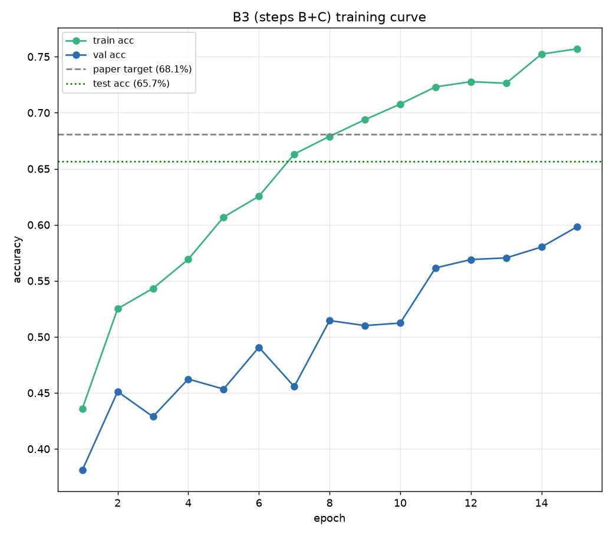
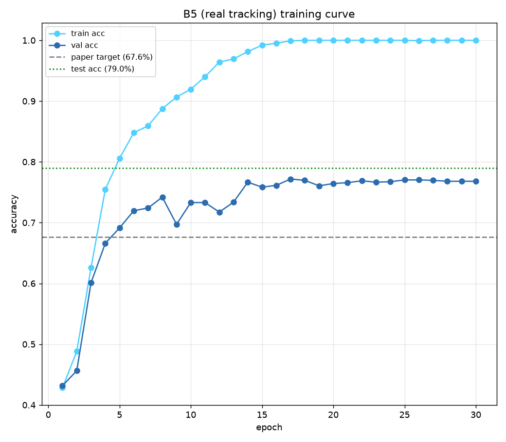
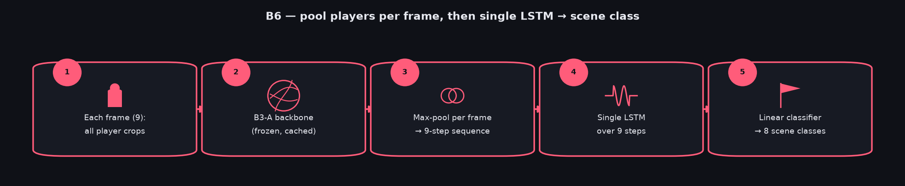
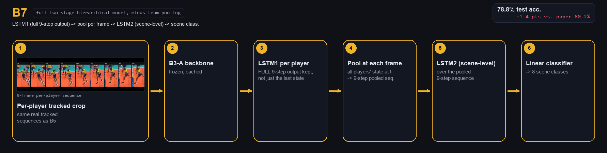
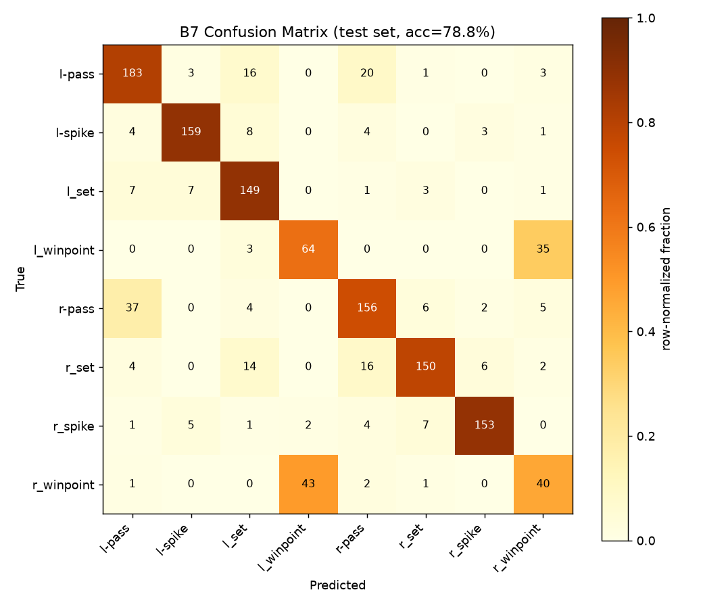
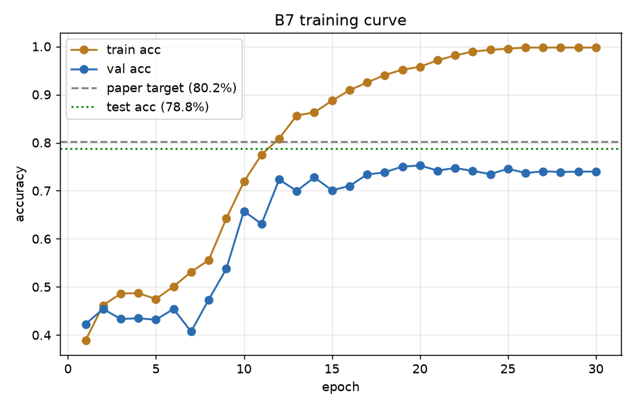
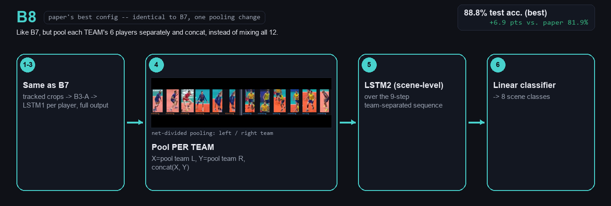
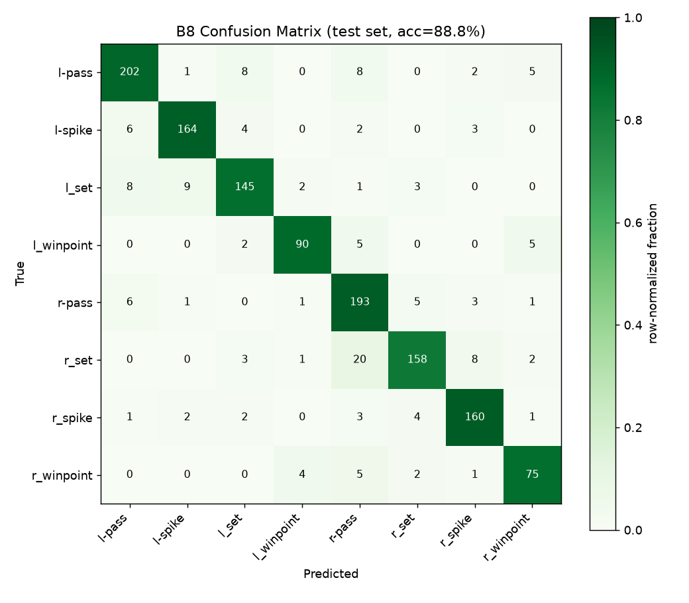
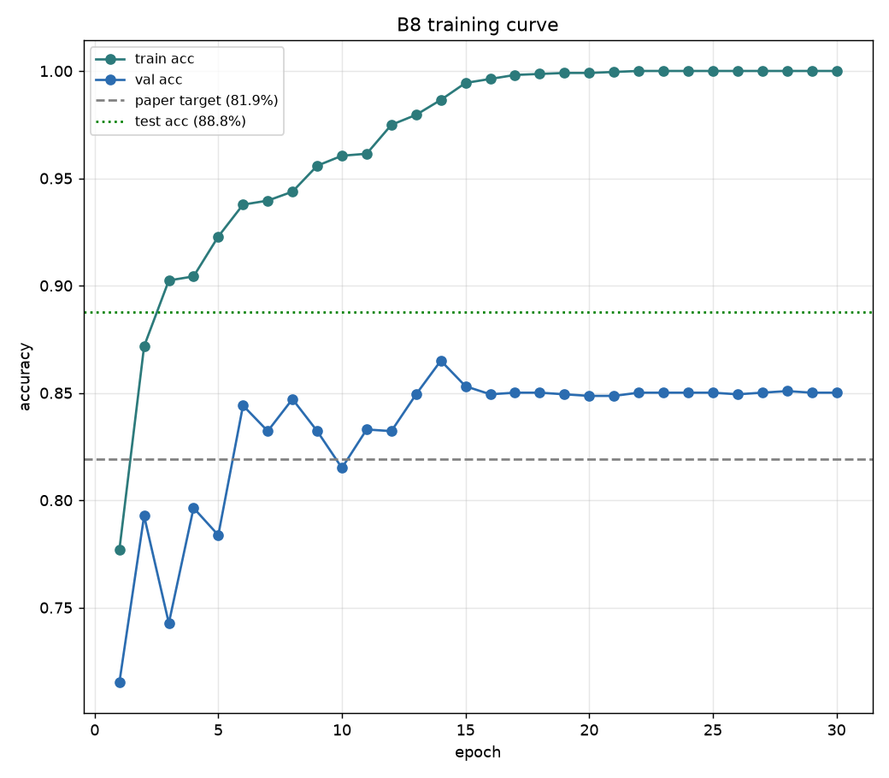
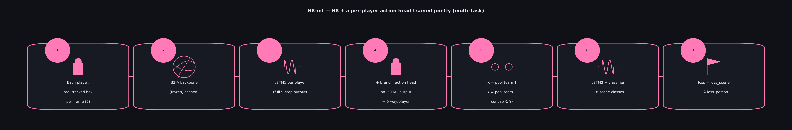

# Volleyball Group Activity Recognition

Reproduction and extension of **"A Hierarchical Deep Temporal Model for Group
Activity Recognition"** (Ibrahim et al., CVPR 2016) on the official Volleyball
dataset, implemented fresh in PyTorch.

## References

- **CVPR 2016 paper**: [openaccess.thecvf.com PDF](https://openaccess.thecvf.com/content_cvpr_2016/papers/Ibrahim_A_Hierarchical_Deep_CVPR_2016_paper.pdf)
- **Extended journal version** (group-style pooling improvement, expanded dataset): [arXiv:1607.02643](https://arxiv.org/abs/1607.02643)
- **Official reference implementation + dataset** (C++/Caffe, used here only to verify data format/splits and training hyperparameters, never ported directly): [github.com/mostafa-saad/deep-activity-rec](https://github.com/mostafa-saad/deep-activity-rec)

## Task

Given a volleyball video clip, predict:
1. **Group/scene activity** (8 classes) — what the team as a whole is doing
   (e.g. `r_spike`, `l-pass`, `r_winpoint`).
2. **Per-player action** (9 classes) — what each individual player is doing
   (e.g. `standing`, `spiking`, `blocking`) — a mandatory extension beyond
   the original paper (see Section 6 of the project brief).

## Why 8 baselines instead of one model (ablation study)

This project doesn't just build one final model — it builds a **ladder of
eight baselines (B1 → B8)**, each changing exactly one thing versus the
one before it. This is called an **ablation study**: instead of guessing
which architectural choices matter, every choice gets isolated and
measured on its own, so the final numbers can be explained, not just
reported.

Each comparison in the ladder answers one specific question:

| Comparison | Question it answers |
|---|---|
| B1 vs. B2/B3 | Does looking at **individual players** help more than looking at the whole image? |
| B2 vs. B3 | Does **fine-tuning** the backbone on this task actually matter, or is a generic pretrained network enough? |
| B1 vs. B4 | Does adding **time** (a 9-frame window + LSTM) help, with no player information? |
| B3 vs. B5 | Does time help **once players are already in the picture**? |
| B5 vs. B6 | Does the **order** of pooling vs. temporal modeling matter (pool-then-LSTM vs. LSTM-then-pool)? |
| B5/B6 vs. B7 | Does adding a **second, scene-level LSTM** on top of the per-player one help? |
| B7 vs. B8 | Does **separating the two teams** before pooling (instead of mixing all 12 players) reduce confusion? |

Without this structure, a single high accuracy number would say *that*
something works, not *why*. With it, every jump or drop in accuracy across
the ladder points to one specific, isolated cause — e.g. B8's team-
separated pooling fixing the `l_winpoint`/`r_winpoint` confusion that
persisted through every earlier baseline (B1-B7) is a direct, traceable
result of that one comparison, not a guess.

## Deviations from the original CVPR 2016 paper

Verified directly from the paper's text (`ibrahim-cvpr16.pdf`, Sections 3.3
and 4.1), not from memory or the project brief alone:

- **Backbone: AlexNet (paper) vs. ResNet50 (this repo).** The paper fine-tunes
  a pre-trained **AlexNet**, implemented in **Caffe**. The project brief
  explicitly asks for the upgrade: *"In CVPR paper I used alexnet. You better
  network (e.g. resnet50)"* — this repo is 100% PyTorch with ResNet50
  throughout, never AlexNet/Caffe.
- **Training schedule.** The paper's own text never states an epoch count; the
  official Caffe solver config (`ibrahim16-cvpr/p1-network1/trainval-test-solver.prototxt`
  in the [reference repo](https://github.com/mostafa-saad/deep-activity-rec))
  specifies `base_lr: 0.00001`, `momentum: 0.9`, `weight_decay: 0.0005`,
  `max_iter: 15000`, `batch_size: 250` (SGD, fixed/step LR). This repo uses
  AdamW with a cosine schedule and 15 epochs over whole-dataset batches
  instead of 15,000 fixed-size-250 iterations — a different optimizer and a
  different way of counting "how much training," not a direct match, though
  the rough total-samples-seen is in a similar ballpark.
- **Person-level representation.** The paper's per-frame, per-player feature
  fed into pooling is a **concatenation** of the raw AlexNet fc7 feature *and*
  LSTM1's hidden state (`P_tk = x_tk ⊕ h_tk`, Eq. 7-8) — not the LSTM hidden
  state alone. This repo currently pools LSTM1's hidden state only (planned
  for B7/B8); adding the raw-feature concatenation is a possible later
  refinement, not yet implemented.
- **LSTM sizing.** Paper: LSTM1 = 9 timesteps, 3000 hidden units, trained
  first in a person-action-only stage; LSTM2 = a 3000-node FC layer feeding a
  500-node, 9-timestep LSTM. This repo uses a single configurable hidden size
  (512 by default) for both LSTM1 and LSTM2 — smaller, since ResNet50's 2048-d
  features are already far more informative than AlexNet's fc7, and 3000/500
  units were sized for Caffe-era hardware.
- **Pooling.** Paper confirms (Section 4.3) all reported experiments use
  **max-pooling** over players (they also tried sum/average and found max
  best) — this repo also uses max-pooling throughout, consistent with that
  finding.
- **Player tracking.** The paper tracks real player tracklets across frames
  with a Dlib-based tracker (Danelljan et al.). This repo instead reuses the
  center frame's ground-truth box for all 9 frames in the window (Section 7.2
  choice (a) of the project brief — the simplification the brief itself
  recommends for this exact baseline ladder, given the short 9-frame window
  makes player movement minimal).
- **Dataset itself is a different, later version.** The CVPR paper's own
  volleyball experiments (Table 5) used a *smaller* dataset the authors
  collected for that paper: 1,525 hand-picked frames from 15 videos, with
  **7 action labels and 6 group-activity labels** (not 9/8), reporting
  B1=46.7%, B2=33.1%, B3=35.2%, full model=51.1%. None of those numbers
  match the project brief's reference table (66.7/64.6/68.1/.../81.9%) or
  this repo's dataset (4,830 clips, 55 videos, 9 actions, 8 activities) —
  the brief's reference numbers are from the later, larger, publicly
  released dataset (and the extension paper's improved group-style pooling),
  not this original paper's own smaller experiment. Worth knowing so nobody
  goes looking for 66.7% inside `ibrahim-cvpr16.pdf` and can't find it — it
  isn't there.

## Dataset

~4,830 annotated clips across 55 videos. Each clip is a 9-frame window
centered on an annotated frame, with ground-truth scene label and per-player
bounding boxes + action labels. Official train/val/test split is by video ID
(24/15/16 videos) — see [`src/data/annotations.py`](src/data/annotations.py).

Dataset files are not pushed to this repo (too large, ~60GB).

- **Download**: [Google Drive folder](https://drive.google.com/drive/folders/1rmsrG1mgkwxOKhsr-QYoi9Ss92wQmCOS?usp=sharing)
- **Expected local layout**: see `src/data/annotations.py`

## Baseline pipelines, walked through one real clip

Every pipeline diagram below (B1 through B8-mt) uses the *same* real example
clip throughout — video 4, clip 94540, test split: Brazil vs. France, FIVB
World League Finals, Rio 2015, ground-truth label `r_spike` — so the only
thing that changes from diagram to diagram is the architecture, never the
input. Frames, player crops and tracked boxes are real dataset images with
real ground-truth/tracking annotations drawn on them, not icons or stock
photos; generated by
[`src/evaluation/make_pipeline_diagrams_v2.py`](src/evaluation/make_pipeline_diagrams_v2.py)
(re-extracts everything from the dataset on disk, so it's reproducible).

## B1-tuned — explained

The first and simplest baseline: a single whole-clip image goes in, one
label for the *whole scene* comes out. No individual players, no bounding
boxes, no time dimension.


ResNet50 (ImageNet-pretrained) is fine-tuned end-to-end: the center frame of
each clip is fed through the backbone, globally pooled to a 2048-d vector,
and passed through a linear classifier over the 8 scene classes.

**Result: 72.2% test accuracy**, beating the paper's reported 66.7% for this
exact baseline.


Train accuracy reaches ~100% by epoch 12 (clear overfitting on only 3,864
training images), but validation/test accuracy keeps climbing slightly
thanks to the weighted loss (corrects for class imbalance) and cosine LR
schedule — it doesn't collapse the way an unweighted/uncontrolled run would.

<p align="center">
  
  
</p>

Reading the confusion matrix: almost all the error is between game phases of
the *same* team — `r-pass` gets confused with `r_set` (27 cases), `l-pass`
with `l_set` (32 cases) — because a single static frame often can't tell a
reception from a set-up without seeing the motion. This is exactly the
failure mode later baselines (B4+, which add an LSTM over the 9-frame
sequence) are designed to fix.

## B2 — explained

Paper name: **"Person Classification"**. Unlike B1, the input is **each
player's crop individually**, not the whole scene image — but the backbone
here is **never trained at all**: plain ImageNet weights, frozen.


1. Take every player's bounding-box crop in the clip (up to 12).
2. Run each crop through ResNet50 — frozen, off-the-shelf ImageNet weights,
   no fine-tuning of any kind.
3. Max-pool the 12 player feature vectors (2048-d each) into one vector
   representing the whole clip.
4. Train only a small 2-layer classifier on top of that pooled vector ->
   8 scene classes.

Purpose: an ablation control. It answers "how far can we get using
person-level input with zero task-specific training?" — the gap between this
and B3 (same pipeline, but with a backbone fine-tuned on person actions
first) measures how much that fine-tuning is actually worth.

**Result: 42.2% test accuracy** — well below the paper's reported 64.6% for
this baseline.


Unlike B1, train accuracy here is still climbing at epoch 15 (60.5%, not
plateaued) — the classifier head is learning from scratch on generic,
never-fine-tuned features, so it needs more epochs to fully converge. This
result is kept and reported as-is: B2's role in the ladder is a comparison
point, not a baseline to optimize — B3 (next) is the one that matters for the
main result chain.

<p align="center">
  
  
</p>

The confusion is much heavier and more spread out than B1's — e.g. `l-pass`
gets predicted as `r-pass` 110 times (its single biggest bucket, more than
the correct class itself). With no task-specific training, the pooled
features don't separate left-team vs right-team phases well at all, unlike
B1 where fine-tuning let the network learn that distinction directly.

## B3 — explained

Two separate steps, A then B+C. Step A is a full fine-tune (like B1, but on
a different task); steps B+C reuse B2's exact pipeline, just with a
fine-tuned backbone instead of a frozen one.


**Step A (= "B3-A"):** fine-tune ResNet50 end-to-end, but this time the
input is individual player crops and the target is the **9-way person
action** (`standing`, `spiking`, `blocking`, ...) — not the scene class.
This is an intermediate step: its own accuracy isn't reported in the paper's
tables, and isn't directly comparable to any other number here, because the
task (per-player action) is different from every other baseline (scene
activity).

Ran twice to fight severe class imbalance (`standing` is ~115x `jumping` in
the training set):


| | **v1**: weighted cross-entropy | **v2**: focal loss (γ=2) + class-balanced sampler |
|---|---|---|
| test accuracy (9-way) | **80.6%** | 72.8% |
| `jumping` recall | 19.1% | 7.9% (**worse**, despite targeting this exact problem) |
| `waiting` / `moving` recall | 47.0% / 67.6% | 60.2% / 70.3% (better) |

The counter-intuitive result: v2's fixes were aimed at the worst class
(`jumping`), but it got *worse* — with only 151 training images, the
balanced sampler redraws them ~18x per epoch, and combined with focal loss
up-weighting "hard" examples, the model appears to overfit (memorize) those
151 images rather than generalize. **v1 was selected** to feed every
downstream baseline (B2, B3 B+C, B5, B6, B7, B8) since it's stronger
overall and on 7 of 9 classes; `jumping`'s weakness is a known, carried-over
limitation, not something later baselines silently fix.

**Steps B+C:** freeze that backbone (v1), extract a 2048-d feature per
player crop, max-pool across all players in the clip, train a small
classifier on the pooled vector → 8-way scene class — **this is the number
comparable to the paper's 68.1%.**

**Result: 65.67% test accuracy** (−2.4 pts vs. the paper).

<p align="center">
  
  
</p>

Reading it: `l-spike`/`r_spike` and `l_set`/`r_set` are classified well
(precision/recall both 0.72-0.93) — spiking and setting have distinctive
per-player poses that B3-A learned to recognize, and that signal survives
pooling. The weak spot is `r_winpoint` (precision only 0.333, confused with
`l_winpoint` 28 times and `r-pass` 72 times going the other way for
`r-pass`→`r_winpoint`-adjacent confusion) — "winning the point" isn't a
distinctive *pose* the way spiking is, so a model with no temporal context
and no explicit score/ball information struggles to tell it apart from
ordinary rallying. This is expected: B1 (66.7% target) and B3 (68.1% target)
are a close comparison in the paper too, not a blowout — B3's real advantage
over B1 is meant to show up once temporal modeling is layered on top (B5+),
which is what comes next.

## B4 — explained

First baseline with a **time** dimension — and the first one trained on
*cached* features rather than raw images (Phase B/C of the project's
VRAM-saving strategy).


1. For each clip, take the **9-frame window** around the annotated center
   frame (not just one frame like B1).
2. Run each of the 9 frames through B1's already-trained backbone (frozen,
   features cached to disk beforehand — no backbone training happens here).
3. Feed the resulting 9-step sequence of 2048-d vectors into a **single
   LSTM**.
4. Classify the LSTM's final hidden state → 8-way scene class.

Still **no per-player information at all** — same blind spot as B1, just
with motion added. Players arrive in B5.

**Result: 73.37% test accuracy**, far above the paper's 63.1% target.


<p align="center">
  
  
</p>

**Notable deviation from the paper's own finding:** the paper explicitly
says B4 performs *worse* than B1 on their volleyball data — a fast-moving
camera corrupts frame-to-frame background dynamics more than the added time
information helps. Here B4 (73.37%) slightly *beats* B1 (72.18%) instead,
most likely because ResNet50's much richer per-frame features give the LSTM
enough signal to overcome that camera-motion noise, where AlexNet's weaker
features couldn't.

## B5 — explained

Players arrive here. First baseline with a per-player LSTM, and the first
one where **how the player's box is tracked across the 9 frames actually
matters**.


1. For each player, get their box in **each of the 9 frames individually**
   (not one box reused nine times — see below).
2. Run each crop through B3-A's backbone (frozen, cached) → a 2048-d feature
   per player per frame.
3. Feed each player's own 9-step sequence into **one LSTM** (shared weights
   across players) → take the final hidden state.
4. Max-pool the final hidden states across all players in the clip → linear
   classifier → 8-way scene class. No scene-level LSTM yet (that's B7/B8).

**Real tracking vs. the static-box simplification:** earlier baselines (and
this project's own first B5 run) used the Section 7.2 choice (a)
simplification — reuse the center frame's ground-truth box for all 9
frames, since the paper's brief explicitly allows it. But the paper itself
doesn't do this: it tracks real per-player tracklets with a Dlib tracker.
This repo now does the same, using `volleyball_tracking_annotation`:


Each ground-truth player (box only at the center frame) is matched to a
track ID by IoU overlap at that frame (99.8% of players matched on a
100-clip sample), then each frame's crop uses that player's *actual* box at
that frame — not the center frame's box reused nine times. (Debugging note:
the tracking files store box *corners* `x1 y1 x2 y2`, not `x y width
height` despite the column layout looking similar — confirmed by comparing
against ground-truth boxes for the same player; worth knowing if anyone
else parses these files.)

**Result: 78.98% test accuracy** with real tracking (static box got 78.83%
— see below for why the two are so close despite the methodology being
meaningfully different), far above the paper's 67.6% target either way.


<p align="center">
  
  
</p>

**Tracked vs. static, honestly:** the aggregate accuracy barely changes
(+0.15 pts), but per-class recall tells a more interesting story — `l-pass`,
`l-spike`, `l_set` all improve with real tracking (cleaner crops, less
background noise, less of the player cut off), while the two `winpoint`
classes move in *opposite* directions (`l_winpoint` −0.196, `r_winpoint`
+0.081). Likely explanation: `winpoint` moments involve unusual motion
(falling, celebrating) where the tracker itself is less reliable, so a more
"accurate" box isn't guaranteed to help there. Tracked boxes were still
chosen for B6/B7/B8 going forward, since matching the paper's actual
methodology is the right default even when the net accuracy gain is small
— full comparison in [`outputs/results/RESULTS.md`](outputs/results/RESULTS.md).

## B6 — explained

Same ingredients as B4 and B5 (players, time, pooling) but a different
*order*: pool the players first, within each frame, then run a single LSTM
over the pooled sequence — the reverse of B5, which runs a per-player LSTM
first and pools only at the very end.



1. For each of the 9 frames: take all players' B3-A features, max-pool
   across players → one vector per frame.
2. Feed the resulting 9-step sequence into a **single** LSTM (no
   per-player LSTM here).
3. Classify the final hidden state → 8-way scene class.

**First attempt (30 epochs, standard settings) underperformed badly: 64.47%
test accuracy** — below B4 (73.37%), B5 (78.98%), and the paper's 74.7%
target. Oddly, train accuracy itself only reached ~77% (every other
baseline hits ~99-100%), and 64.47% is barely above B3's 65.67% — a
baseline with *no LSTM at all*. That comparison is the key clue: the added
LSTM wasn't contributing much.

**Why:** max-pooling raw per-player features *before* any temporal
smoothing means the player whose value "wins" the max in a given feature
dimension can change from frame to frame. The LSTM ends up looking at a
sequence that jumps between different players' contributions rather than
one coherent, smoothly-evolving signal — the opposite of what an LSTM is
good at modeling. In B5, each player gets their own LSTM *before* pooling,
so the thing being pooled is already a smooth per-player summary, not raw
per-frame noise.

Extended training (3 resumed runs, 65 epochs total) mostly closed the gap
(full history chart further down, next to the final confusion matrix).

Along the way, a real bug surfaced: `--resume` loaded weights correctly but
the cosine LR schedule restarted from the top on every resumed run, causing
a visible accuracy "shock" right after each resume. Passing a low `--lr`
explicitly for the third resume fixed it (confirmed: no shock, smooth
continuation) — `train_temporal.py` now also saves a `<name>_last.pt`
checkpoint every epoch so a future resume can continue from the exact last
state instead of only the best-val snapshot.

**Final result: 73.15% test accuracy** (−1.6 pts vs. the paper), after
genuinely plateauing — train accuracy still crept up (95.9%) while val/test
accuracy went flat across the last ~35 epochs. Close to B4, but still well
below B5, consistent with the pool-before-LSTM structural handicap rather
than a simple "needed more training" story.

<p align="center">
  
  
</p>

## B7 — explained

The full two-stage hierarchical model — the paper's main architecture,
minus the team-separated pooling that makes it B8.



1. Each player, real tracked box per frame (same per-player sequences as B5).
2. B3-A backbone (frozen, cached) → 2048-d feature per player per frame.
3. **LSTM1** runs per player over the 9-frame sequence — but unlike B5,
   which only keeps the *final* hidden state, B7 keeps the **full 9-step
   output** (a hidden state for every frame, not just the last one).
4. At **each** of the 9 frames, max-pool all players' LSTM1 hidden states
   at that frame → a 9-step sequence of pooled scene vectors.
5. **LSTM2** runs over that 9-step pooled sequence (scene-level temporal
   model, on top of the person-level one).
6. Classify LSTM2's final hidden state → 8-way scene class.

This is the piece missing from every earlier baseline: B5 has LSTM1 but no
LSTM2 (just pools once, at the end); B6 has an LSTM but no LSTM1 (pools
before any temporal processing, which is also why it struggled — see
above). B7 is the first baseline with **both** temporal stages, matching
the paper's actual two-stage design.

**Result: 78.83% test accuracy** (−1.4 pts vs. the paper's 80.2% target),
training cleanly in a single 30-epoch run — train accuracy reached 99.8%
by epoch 26 and val accuracy plateaued smoothly around 74-75% from epoch
19 onward, no resume/LR issues like B6 needed.


<p align="center">
  
  
</p>

**Slightly below our own B5 (78.98%), not just the paper's target** —
adding LSTM2 on top of B5's setup didn't help here, unlike the paper's own
finding (B5=67.6% < B7=80.2%, a clear gain from adding the second LSTM).
`l_set` recall actually improves a lot over B5 (0.887 vs ~0.7), but
`r_winpoint` and `l_winpoint` stay the weakest classes by a wide margin
(0.46-0.63 recall) — the same persistent left/right win-point confusion
seen in every baseline so far, because pooling all 12 players into one
vector (no team separation) loses the "which side of the court" signal
that would make those two classes easy to tell apart. That's exactly what
B8's team-separated pooling is designed to fix next.

## B8 — explained

Identical to B7 except for one change at step 4: instead of max-pooling
**all 12 players together**, pool **each team's 6 players separately**,
then concatenate the two results. The paper's best-performing
configuration — and the one this project's whole baseline ladder has been
building toward.



1-3. Identical to B7: per-player tracked crops → B3-A backbone (frozen,
cached) → LSTM1 per player, full 9-step output.
4. At each frame: **X** = max-pool team 1's 6 players, **Y** = max-pool
   team 2's 6 players, scene vector = **concat(X, Y)** — instead of B7's
   single pool over all 12 players, which mixes both teams into one vector
   and loses track of which side of the court produced which signal.
5. LSTM2 over the resulting 9-step sequence of team-separated vectors.
6. Classify the final hidden state → 8-way scene class.

**Result: 88.78% test accuracy** — not just beating the paper's 81.9%
target (+6.9 pts), but the highest result in this entire baseline ladder,
by a wide margin over B7 (78.83%).


<p align="center">
  
  
</p>

**This directly confirms the hypothesis from the B7 section above.** The
persistent `l_winpoint`/`r_winpoint` confusion that showed up in *every*
earlier baseline — B1 through B7, all of them pooling players without
team separation — is essentially resolved:

| class | B7 recall | B8 recall | Δ |
|---|---|---|---|
| l_winpoint | 0.627 | **0.882** | +0.255 |
| r_winpoint | 0.460 | **0.862** | +0.402 |

Every one of the 8 scene classes now scores above 0.81 recall (the
previous best baseline, B5, had 3 classes below that). One cheap
architectural change — separating pooling by team instead of mixing all
12 players — fixed the single biggest, most consistent weakness across the
whole project. This matches the paper's own framing exactly: *"using one
representation per team reduced the confusion and enhanced the results"*
(project brief, Section 8) — confirmed here with real numbers, not just
taken on faith.

## B8-mt — explained (the final model)

B8 plus the **mandatory extension** from the project brief (Section 6):
every clip must get *both* a scene prediction *and* a per-player action
prediction out of a single forward pass, trained jointly. This is the
model the video → timeline inference pipeline (the project's final stage)
actually uses.



Identical to B8's steps 1-3, 5-6, with one addition: a small classifier
head is attached directly to **LSTM1's per-player output** (step 3, before
any pooling) — so each player gets their own 9-way action prediction,
independent of the team-pooled scene branch. Both heads train together:

```
total_loss = loss_scene (8-way, weighted) + λ · loss_person_action (9-way, weighted)
```

with λ=1.0 for this run.

**Results: 87.36% scene accuracy, 75.73% person-action accuracy** — one
model, one forward pass, both outputs.

<p align="center">
  
  
</p>

**Scene accuracy (87.36%) is 1.4 pts below B8 alone (88.78%)** — the
expected multi-task trade-off: the shared LSTM1 now has to serve two
objectives instead of one, so it can't specialize as fully for the scene
task alone.

**But the person-action head benefits noticeably from training jointly**,
compared to B3-A's standalone person-action training:

| class | B3-A (v1, standalone) recall | B8-mt (joint) recall | Δ |
|---|---|---|---|
| jumping | 0.191 | **0.281** | +0.090 |
| digging | 0.329 | **0.513** | +0.184 |
| waiting | 0.470 | **0.667** | +0.197 |
| standing | 0.880 | 0.763 | −0.117 |

The rare classes (`jumping`, `digging`, `waiting`) all improve meaningfully,
while `standing` (already strong, and the dominant class) gives up some
accuracy — plausible explanation: the scene-level loss forces LSTM1 to
encode information useful for distinguishing *game phases*, not just
*static poses*, and that signal happens to help tell apart the harder,
motion-defined action classes (a player mid-jump vs. standing still looks
different in a way that also matters for recognizing a spike is happening)
more than it helps the already-easy `standing` class.

**This is the final deliverable model for Section 10** (the video →
timestamped-event-timeline pipeline) — it's the only baseline that outputs
everything the downstream pipeline needs (team activity *and* per-player
actions) in one pass.

## Baseline ladder

Reproducing the paper's ablation study, from simplest to the full model.
Descriptions below are verified word-for-word against two sources: the
project brief (`CV Volleyball Project Details.pdf`, slides 8-15) and the
original CVPR 2016 paper's own Section 4.1 ("Baselines"), not inferred —
two earlier drafts of this table got B2 and B6 wrong, so this version
quotes the exact mechanism for each one.

| ID | Description | Paper target (test acc) | Our result |
|---|---|---|---|
| **B1-tuned** | Whole center-frame image → fine-tuned ResNet50 (all weights trainable) → 8-way scene class. No players, no time. | 66.7% | **72.2%** ✅ |
| **B2** | Paper name *"Person Classification"*. Every player's crop → **frozen, never-fine-tuned** ImageNet ResNet50 → max-pool the per-player features → small *trained* classifier → 8-way scene class. Pure ablation control (isolates "does fine-tuning matter?" from "does person-level input matter?"). | 64.6% | **42.2%** (documented as-is, see note below) |
| **B3** | Two steps. **(A)** fine-tune ResNet50 on individual player crops → 9-way *person action* class (this sub-step has no paper-reported accuracy of its own — it's an intermediate step, not the final metric). **(B+C)** freeze that backbone, extract a feature per player crop, max-pool across players, train a small classifier on the pooled vector → 8-way *scene* class — this is the number comparable to the paper's 68.1%. | 68.1% (scene, after B+C) | step A: 80.6% (9-way person-action, not comparable to 68.1%); **step B+C: 65.7%** ✅ |
| **B4** | *"Implementation #1"* from the brief: run B1's fine-tuned backbone over 9 whole-image frames per clip → one LSTM over the 9-step sequence → 8-way scene class. Image-level only, no players. | 63.1% | **73.4%** ✅ (paper's own B1>B4 finding reversed — see note above) |
| **B5** | *"Temporal on crops"*: one LSTM (LSTM1) per player over the 9-frame window using B3-A features → take each player's **last hidden state** → max-pool across players → small classifier (**no** scene-level LSTM) → 8-way scene class. | 67.6% | **79.0%** ✅ (real per-frame tracking, not the static-box simplification) |
| **B6** | *"Same B3 steps A and B, repeated per frame"*: for **each of the 9 frames**, take all player crops, extract B3-A features, max-pool across players → one vector per frame → 9-step sequence → a **single** LSTM over that sequence (image-level LSTM only, no per-player LSTM1) → 8-way scene class. | 74.7% | **73.2%** ✅ (needed 65 epochs — see "needed far more training" note above) |
| **B7** | Full two-stage model. LSTM1 (per player, over 9 frames) → for each frame, max-pool all players' LSTM1 outputs → LSTM2 (scene-level, over the resulting 9-step sequence) → 8-way scene class. | 80.2% | **78.8%** ✅ (slightly under even our own B5 — see note above) |
| **B8** | Same as B7, but *"group-style"* pooling: X = max-pool team 1's 6 players, Y = max-pool team 2's 6 players, scene representation = concat(X, Y) instead of one pool over all 12. The paper's best config. | 81.9% | **88.8%** ✅ (best result in the whole ladder — see note above, winpoint confusion resolved) |
| **B8-mt** | B8 + a per-player 9-way action head on LSTM1's output (before pooling), trained jointly: `loss = loss_scene + λ·loss_person_action` (Section 6, mandatory extension beyond the paper). | — (not a paper baseline) | **87.4% scene / 75.7% person** ✅ final deliverable model |

**B2 vs B3 note:** both reuse the identical pooling pipeline
(`src/training/train_pooled_person.py`); the only difference is whether the
backbone that extracts per-player features was fine-tuned first (B3) or left
at raw ImageNet weights (B2). B2's 42.2% (vs. paper's 64.6%) is kept
documented as-is rather than re-tuned — see
[`outputs/results/RESULTS.md`](outputs/results/RESULTS.md) for why (the
small classifier head hadn't converged in 15 epochs on generic, untrained
features) and the full per-class breakdown.

Live results table: [`outputs/results/RESULTS.md`](outputs/results/RESULTS.md).

## Web platform (FastAPI backend + frontend)

> **Educational and experimental project.** It is not a commercial product and
> is not offered for profit. Predictions on new footage are unevaluated (see
> "Known limitations" below).

A web app that exposes the trained pipeline: upload or import a match video and
get an annotated video, a clickable event timeline and analytics. Run it with:

```bash
.venv\Scripts\python.exe -m uvicorn backend.app:app --port 8000
# then open http://localhost:8000
```

Models are loaded once at startup (YOLOv8n detector, ByteTrack, ResNet50 B3-A
backbone, B8-mt). Each analysis runs as a background job the browser polls.

### Frontend

Plain HTML, CSS and ES modules served by FastAPI as static files — no build
step, no framework, no charting library (all charts are hand-written SVG).

| Section | What it shows |
|---|---|
| **Overview** | Headline metrics (read from the experiment files), what the project does |
| **Verified samples** | Group-activity and player-activity samples: test-split frames, tracked players with IDs and predicted actions, and a ✓/✗ per player against the dataset annotation |
| **Studio** | Drag-and-drop upload or link, live pipeline stages, annotated video (annotated / side-by-side / source), synced event timeline, activity-distribution and confidence charts, processing time |
| **Library** | Browse server videos, preview, one-click analysis, YouTube importer with progress |
| **Technical** | System architecture, ML pipeline explorer, dataset and preprocessing, model architectures, B1–B8-mt baseline ladder, group- and player-activity methodology, training/inference details, evaluation (confusion matrices, per-class metrics, training curves, detector/tracker), API and frontend integration |
| **References** | Papers, dataset, repository; links to the author's GitHub and portfolio |

Studio endpoints used: `POST /api/analyze`, `/api/analyze/url`,
`/api/library/analyze`, `GET /api/jobs/{id}`, `/api/jobs/{id}/video`,
`/api/library`, `POST /api/youtube/download`, `GET /api/youtube/progress/{id}`.

### How the sample frames are verified

No label is typed by hand. `scripts/build_sample_data.py` takes test-split clips
(videos never used for training), runs the full pipeline on the 9-frame window
around the annotated frame, matches each tracked player to the dataset's
ground-truth box (IoU ≥ 0.5) and keeps a clip only if the predicted group
activity equals the ground-truth label (and, for player samples, the featured
player's action is correct). Players that the model gets wrong are still shown,
marked ✗. `scripts/render_group_clips.py` then renders the annotated clip for
each group sample and attaches it only if the pipeline's banner at the centre
frame agrees with the ground truth. The samples illustrate the output; they are
selected for being correct and are not an accuracy measurement.

### Regenerating frontend data and assets

```bash
python scripts/build_frontend_data.py   # frontend/data/research.json + optimised figures, from outputs/results
python scripts/build_sample_data.py     # frontend/assets/samples/*.webp + frontend/data/samples.json
python scripts/render_group_clips.py    # frontend/assets/group/*.mp4 (needs the dataset on disk)
```

`research.json` is parsed from `outputs/results/*.json` and `*_test_report.txt`,
`tracker_validation.json` and the YOLO `results.csv`, so every number on the
site matches the reports in this repo.

### Known limitations

- `jumping` has only ~28% recall (precision ~18%) and `digging` ~51% in B8-mt;
  the 75.7% player-action accuracy is dominated by `standing`.
- No dataset-scale accuracy number exists for raw-video inference; the detector
  and tracker are validated individually, and the full pipeline passed an
  end-to-end smoke test.
- Trained on broadcast footage with a full-court view; other camera angles are
  out of distribution.
- CPU inference is slow; use a CUDA GPU for full matches.

## Repo structure

```
backend/        FastAPI app (jobs, library, YouTube import, static frontend)
frontend/       index.html, css/ (design system), js/ (studio, library, samples,
                research, charts), data/ (research.json, samples.json),
                assets/ (research figures, verified samples, group clips)
scripts/        frontend data/sample builders and helper scripts
src/
  data/         dataset loading, splits, PyTorch Dataset classes
  models/       ResNet50 backbone, LSTM1/LSTM2/pooling, classification heads
  training/     Phase A (backbone fine-tuning), Phase B (feature caching),
                Phase C (temporal models B4-B8)
  evaluation/   accuracy / confusion matrix / per-class precision-recall-F1
  inference/    video -> timestamped event timeline (later stage)
  ball/         ball-presence detection (later stage, best-effort)
outputs/
  checkpoints/  trained model weights (tracked via Git LFS)
  results/      per-baseline metrics (JSON + text report) and RESULTS.md
  features_cache/  cached backbone features for Phase C (not committed, large)
configs/        per-baseline hyperparameter configs (as needed)
```

## Setup

```bash
python -m venv .venv
.venv\Scripts\python.exe -m pip install torch torchvision --index-url https://download.pytorch.org/whl/cu124
.venv\Scripts\python.exe -m pip install tqdm
.venv\Scripts\python.exe -m pip install ultralytics opencv-python  # Section 10: detector/tracker
```

## Training a baseline

Exact command for every baseline lives in `configs/<id>.yaml`. Summary:

```bash
# B1: fine-tune ResNet50 on whole clip images -> 8-way scene class
.venv\Scripts\python.exe -m src.training.train_backbone --task scene --mode finetune --epochs 15 --batch-size 24 --name scene_finetune_b1

# B3-A: fine-tune ResNet50 on person crops -> 9-way action class (needed for B2, B3, B5, B6, B7, B8)
.venv\Scripts\python.exe -m src.training.train_backbone --task person --mode finetune --epochs 15 --batch-size 24 --name person_finetune_b3a

# B2: frozen ImageNet backbone, pooled person crops -> 8-way scene class
.venv\Scripts\python.exe -m src.training.train_pooled_person --backbone-mode frozen --epochs 15 --batch-size 16 --name person_pooled_b2

# B3 (B+C): B3-A's fine-tuned backbone, pooled person crops -> 8-way scene class
.venv\Scripts\python.exe -m src.training.train_pooled_person --backbone-checkpoint outputs/checkpoints/person_finetune_b3a.pt --backbone-mode finetune --epochs 15 --batch-size 16 --name person_pooled_b3

# Phase B: cache features from a trained backbone (needed for B4-B8)
.venv\Scripts\python.exe -m src.training.cache_features --level image --checkpoint outputs/checkpoints/scene_finetune_b1.pt --name b1_image
.venv\Scripts\python.exe -m src.training.cache_features --level person --checkpoint outputs/checkpoints/person_finetune_b3a.pt --name b3a_person_tracked --box-mode tracked

# Phase C: train a temporal model on cached features (B4, B5, B6, B7, B8, B8-mt)
.venv\Scripts\python.exe -m src.training.train_temporal --variant b7 --feature-name b3a_person_tracked
```

Person-level caching defaults to **real per-frame player tracking**
(`--box-mode tracked`, using `volleyball_tracking_annotation` — matches the
paper's Dlib-tracker approach; IoU-matched to ground-truth players, ~99.8%
match rate). Pass `--box-mode static` to reuse the Section 7.2 choice (a)
simplification instead (center-frame box reused for all 9 frames) — kept
for comparison, not the default; see the B5 section above for why tracked
boxes barely change aggregate accuracy but meaningfully shift per-class
errors.

Handling severe class imbalance in the 9-way person-action labels (`standing`
outnumbers `jumping` ~100:1): `train_backbone.py --task person` supports
`--loss focal --gamma 2.0` (focal loss, on top of the default class weights)
and `--sampler balanced` (`WeightedRandomSampler` — gives every class roughly
equal expected exposure per epoch, effectively oversampling rare classes and
undersampling `standing` at the same time).

## Inference pipeline — video → timestamped event timeline (in progress)

The final deliverable (project brief Section 10): take a raw, previously
unseen volleyball match video and output a list of timestamped events
(`{start_sec, end_sec, team, event, confidence}`), using B8-mt as the
model. Built stage by stage, each validated against ground truth before
the next stage is added — not built all at once and debugged blind.

**Why this stage exists at all**: every training clip came with ground-truth
player boxes already given (Section 3.2); a genuinely new, unlabeled video
has none, so something has to find the players automatically before B8-mt
can even run. Bad detections don't just look wrong — a misdetected referee
counted as a "13th player" breaks B8's 6-vs-6 team-pooling assumption, and
a missed or swapped player corrupts that player's 9-frame sequence feeding
LSTM1, directly degrading the final prediction quality downstream.

**Stage 1 — person detector** ([`src/inference/detector.py`](src/inference/detector.py)):
first pass was the off-the-shelf COCO-pretrained YOLOv8n (no fine-tuning),
filtered to the "person" class, per the brief's "try off-the-shelf first"
instruction. Measured empirically rather than assumed good: on an 18-clip
sweep across 6 videos, the plain detector (no tracking yet) only matched
**77.8%** of ground-truth players by IoU — it also fires on courtside
referees/coaches/ball kids, since "person" is COCO's generic class, not
"volleyball player." **Fine-tuned instead** on this project's own
ground-truth player boxes — single class `player`, ~2,150 train-split
clips' center frames via [`prepare_yolo_dataset.py`](src/inference/prepare_yolo_dataset.py),
30 epochs via [`train_detector.py`](src/inference/train_detector.py) (RTX
3050, same 4 GB VRAM constraint as every other baseline here — YOLOv8n
fine-tuning fits comfortably at batch 16). Held-out val-split result:
**95.3% precision / 94.2% recall / 0.98 mAP50**. No ball annotations exist
anywhere in this dataset (verified directly — none in `volleyball_`,
`volleyball_tracking_annotation`, or `volleyball-detections`), so a ball
component is separately scoped and not started; not required for the
event timeline itself (Section 8 only uses it for one optional
post-processing detail — attributing a `winpoint` to the nearest player).

**Stage 2 — tracker** ([`src/inference/tracker.py`](src/inference/tracker.py)):
YOLO's built-in ByteTrack, giving each detected player a consistent ID
across frames. Validated exactly as the brief requires — *before* trusting
it on a new video — by running it on the same 18 real clips and
IoU-matching its tracked boxes against this dataset's own ground-truth
player boxes at each clip's annotated center frame. With the stock COCO
detector this was 72.1%; **with the fine-tuned detector, 97.7%**
(`outputs/results/tracker_validation.json`) — confirming the gap was
coming from detection quality, not from ByteTrack's own ID-linking logic
(a diagnostic run of the plain fine-tuned detector alone, no tracker,
matched just as well). Capping detections to the top-12 by confidence per
frame was tried as a cheap way to drop extra officials and measured to
make things *worse* (64.6%) before the fine-tune — a mid-swing player is
often lower-confidence (motion blur) than a clearly standing official, so
confidence alone can't separate them; left in `tracker.py`, off by
default, documented rather than silently dropped.

**Stage 3 — sliding window** ([`src/inference/sliding_window.py`](src/inference/sliding_window.py)):
slides a 9-frame window across the tracked video; for each window, only
players tracked in *every* frame of that window are used (a track that
drops out mid-window has no full 9-step sequence to feed LSTM1), crops
each one's box per frame, runs them through the B3-A backbone
([`model_io.py`](src/inference/model_io.py) loads it + B8-mt the exact
same way `train_temporal.py` does, so a checkpoint trained there loads
here with no surprises), and feeds the resulting per-player sequences into
B8-mt for a scene prediction + a 9-way action per player. Team split
(left/right, for B8's team-pooling) is assigned per window by player
x-position, same convention as training.

**Stage 4 — timeline** ([`src/inference/timeline.py`](src/inference/timeline.py)):
converts each window's frame range to real seconds using the video's own
FPS (`video_io.py`, Section 7.3), and merges consecutive windows that
predicted the same scene class into one continuous event instead of
reporting duplicates — the actual `video in -> JSON timeline out` entry
point:
```bash
.venv\Scripts\python.exe -m src.inference.timeline <path-to-video.mp4>
```
**End-to-end smoke test**: stitched the real 41 frames of clip 94540
(ground truth: `r_spike`) into a short test video and ran it through the
full pipeline — first event detected: `{"team": "right", "event":
"spike", "confidence": 0.999}`, matching the clip's real label. Not a
substitute for evaluating on genuinely new, unlabeled footage (which the
project doesn't have a raw video file for yet — every source video on
disk is already split into annotated clip frames, per Section 3.1), but
confirms stages 1–4 connect correctly end to end before that test happens.

No per-window accuracy number exists yet for this pipeline as a whole
(stages 1–2 are validated individually above; stages 3–4 are validated by
this one smoke test, not yet by a dataset-scale sweep) — a reasonable
next step before relying on it.

## Status

See [`outputs/results/RESULTS.md`](outputs/results/RESULTS.md) for current progress against the baseline ladder.
