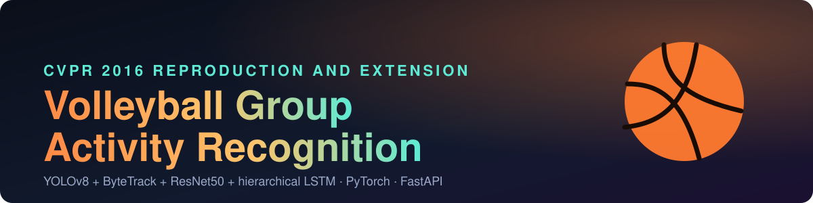
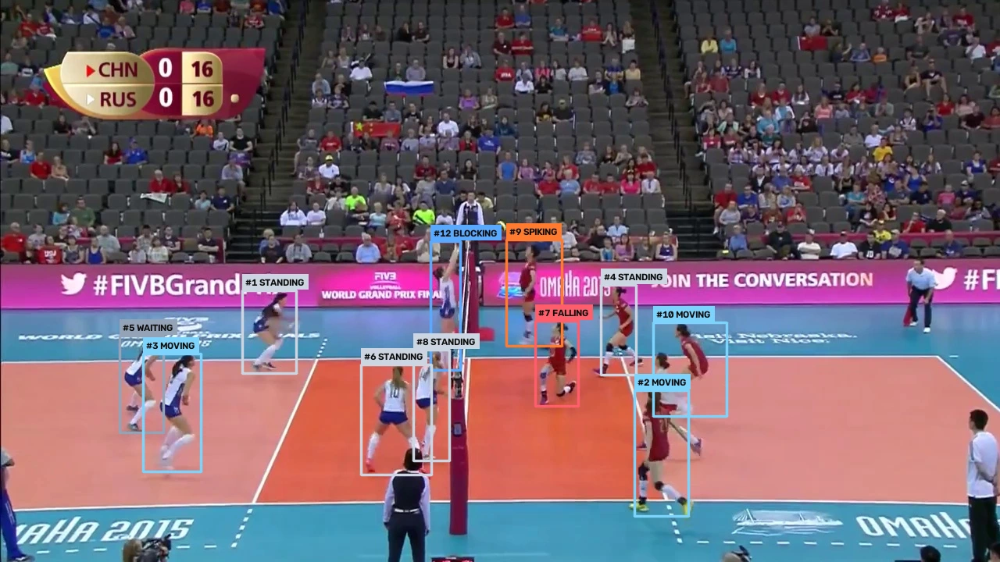
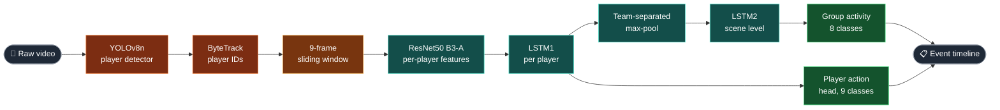
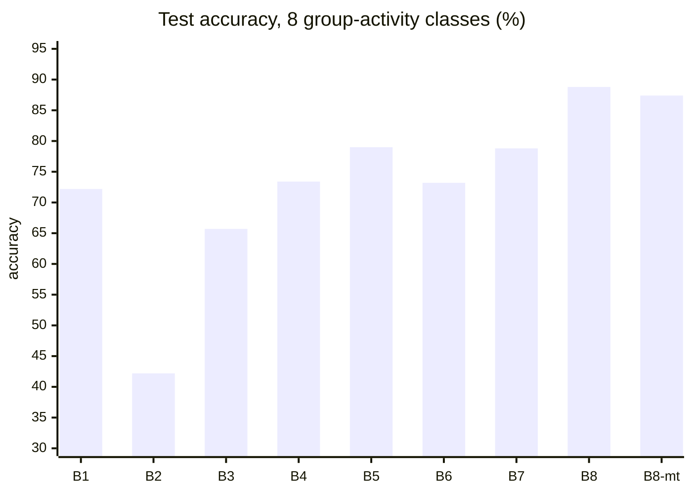
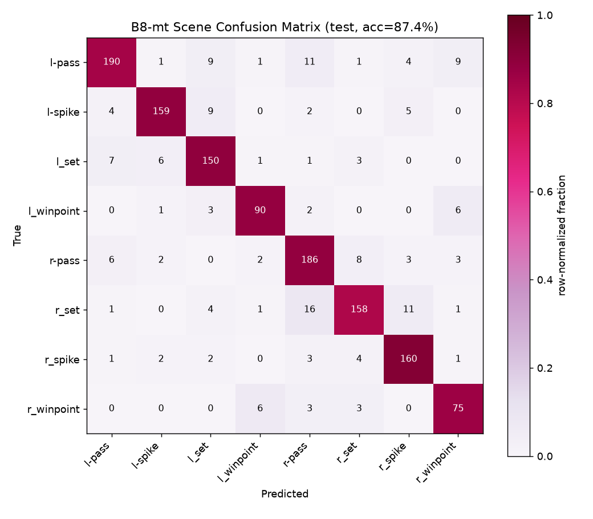
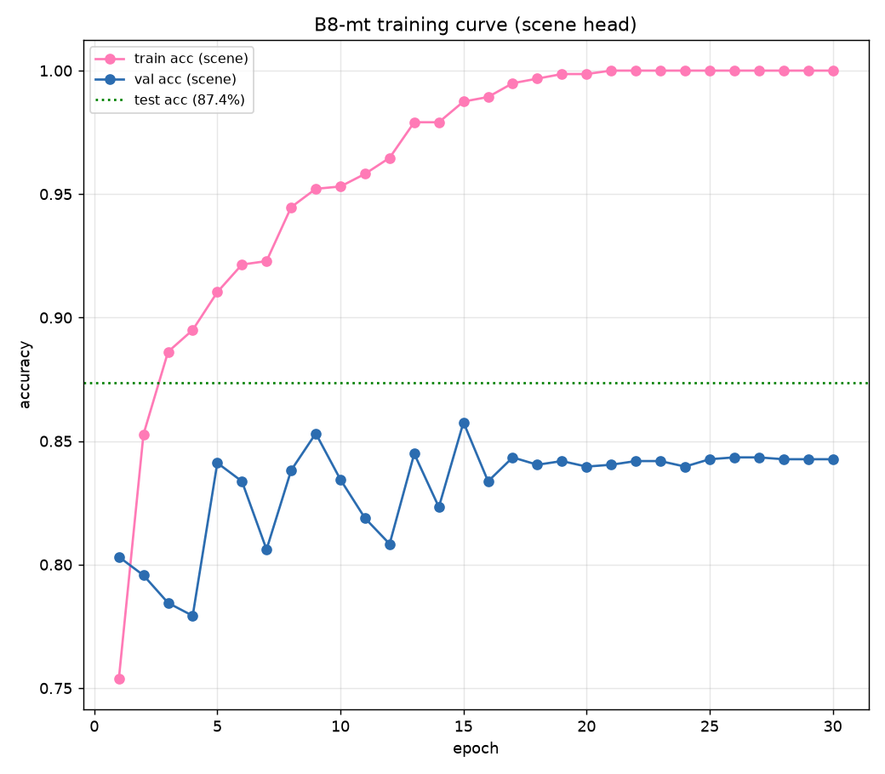
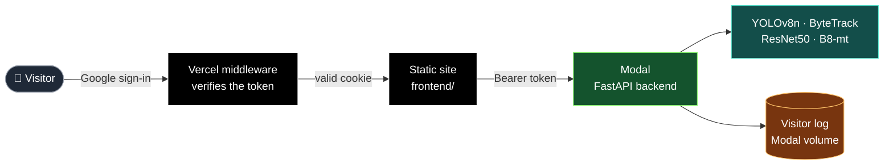

<div align="center">



<br>

[](https://volleyball-group-activity-recogniti.vercel.app)
[](https://modal.com)
[](https://openaccess.thecvf.com/content_cvpr_2016/papers/Ibrahim_A_Hierarchical_Deep_CVPR_2016_paper.pdf)


**Upload a volleyball match. Get back what each team and each player is doing, as an annotated video and a clickable event timeline.**

[Live demo](https://volleyball-group-activity-recogniti.vercel.app) ·
[Results](#-results) ·
[How it works](#-how-it-works) ·
[Run it](#-run-it-yourself) ·
[Baselines in detail](docs/BASELINES.md)

</div>

> [!NOTE]
> **Educational and experimental project.** It is not a commercial product and is not offered for profit.
> Predictions on new footage are unevaluated; see [Known limitations](#-known-limitations).


## 🎬 Preview

<p align="center">
  
  <br>
  <sub>Real model output on a held-out test clip: every tracked player with ID and predicted action, plus the team-level banner.</sub>
</p>

## 📊 At a glance

| | |
|---|---|
| 🏐 **Group activity** (8 classes) | **87.4 %** test accuracy with B8-mt (best single-task B8: **88.8 %**, paper: 81.9 %) |
| 🧍 **Player action** (9 classes) | **75.7 %** test accuracy, from the same forward pass |
| 🔎 **Player detector** (YOLOv8n, fine-tuned) | **95.3 %** precision · **94.2 %** recall · **0.98** mAP50 |
| 🧭 **Tracker** (ByteTrack) | **97.7 %** of ground-truth players matched |
| 📚 **Dataset** | 4,830 clips · 55 videos · split by video 24 / 15 / 16 |
| 🌐 **Live** | Vercel front end + Modal API, Google sign-in required |


## 🎯 What it does

Reproduction and extension of **"A Hierarchical Deep Temporal Model for Group Activity Recognition"**
(Ibrahim et al., CVPR 2016) on the official Volleyball dataset, implemented fresh in PyTorch with
a stronger backbone and a full video pipeline on top.

| Output | Classes | Examples |
|---|---|---|
| **Group activity** | 8 | `r_spike`, `l-pass`, `r_winpoint`: what the whole team is doing |
| **Player action** | 9 | `standing`, `spiking`, `blocking`: what each player is doing |
| **Event timeline** | n/a | `{start_sec, end_sec, team, event, confidence}` for a raw match video |


## ⚙️ How it works



| Stage | What it does | Code |
|---|---|---|
| **1 Detector** | YOLOv8n fine-tuned on this dataset's player boxes, so referees and ball kids are not counted as players | [`src/inference/detector.py`](src/inference/detector.py) |
| **2 Tracker** | ByteTrack keeps one ID per player across frames | [`src/inference/tracker.py`](src/inference/tracker.py) |
| **3 Sliding window** | 9 frames at a time; only players tracked in every frame are used | [`src/inference/sliding_window.py`](src/inference/sliding_window.py) |
| **4 Model** | ResNet50 features, LSTM1 per player, team-separated pooling, LSTM2, two heads | [`src/models/`](src/models) |
| **5 Timeline** | Windows converted to seconds and merged into events | [`src/inference/timeline.py`](src/inference/timeline.py) |


## 🏆 Results

The project is an **ablation ladder of eight baselines (B1 to B8)**. Each one changes exactly one thing
from the one before, so every gain or loss has a single, traceable cause.



| ID | What changes | Paper | **Ours** | |
|---|---|---|---|---|
| **B1** | Whole frame, fine-tuned ResNet50 | 66.7 | **72.2** | 🟢 |
| **B2** | Player crops, *frozen* ImageNet backbone | 64.6 | **42.2** | 🔴 kept as a control |
| **B3** | Player crops, fine-tuned backbone, max-pool | 68.1 | **65.7** | 🟠 |
| **B4** | Adds time: 9 frames, one LSTM | 63.1 | **73.4** | 🟢 |
| **B5** | Per-player LSTM, real tracking | 67.6 | **79.0** | 🟢 |
| **B6** | Pool first, then one LSTM | 74.7 | **73.2** | 🟠 |
| **B7** | Two LSTMs (player, then scene) | 80.2 | **78.8** | 🟠 |
| **B8** | **Team-separated pooling** | 81.9 | **88.8** | 🟢 best |
| **B8-mt** | B8 + per-player action head, trained jointly | n/a | **87.4** scene · **75.7** player | 🟢 final model |

> [!TIP]
> **The one change that mattered most:** pooling each team's six players separately (B7 to B8) lifted
> `l_winpoint` recall from 0.63 to 0.88 and `r_winpoint` from 0.46 to 0.86, and fixed the left/right
> win-point confusion that every earlier baseline kept.

<details>
<summary><b>Confusion matrices and training curves of the final model</b></summary>

<p align="center">
  
  
</p>

</details>

📖 **Full write-ups for every baseline, the deviations from the paper and the per-class analysis:**
[`docs/BASELINES.md`](docs/BASELINES.md) · live numbers: [`outputs/results/RESULTS.md`](outputs/results/RESULTS.md)


## 🌐 Web platform

A web app exposes the trained pipeline: upload a match video, get an annotated video, a clickable
event timeline and analytics. Plain HTML, CSS and ES modules, no build step, no framework, hand-written SVG charts.



| Section | What it shows |
|---|---|
| **Overview** | Headline metrics read from the experiment files; autoplaying hero with a switch between one verified clip per group activity |
| **Verified samples** | Test-split frames with tracked players, IDs and predicted actions |
| **Videos** | Looping annotated clips for **all 8 group activities** and 4 player actions, no controls, about 12 s each |
| **Studio** | Upload, live pipeline stages, annotated video, synced event timeline, charts |
| **Library** | Dataset rallies, one-click analysis |
| **Technical** | Architecture, model details, baseline ladder, evaluation, API |
| **Admin** | Visible only to admin accounts: who signed in, when, and how many analyses |

### 🔐 Access and tracking

- **Nothing is served without a Google sign-in.** [`frontend/middleware.js`](frontend/middleware.js) runs on every request and verifies the Google ID token (signature, issuer, audience, expiry, verified email). Pages get the login page, other files get `401`.
- The API verifies the same token on `/api/analyze`, `/api/library/analyze` and `/api/analyze/url` ([`backend/auth.py`](backend/auth.py)).
- Every sign-in and analysis is recorded with the Google email. Admin accounts (`ADMIN_EMAILS`) see the list in the site's **Admin** section, read from `GET /api/visitors`.
- Optional `ALLOWED_EMAILS` restricts who may enter. With no `GOOGLE_CLIENT_ID` set, the wall is off, which is the default for local runs.
- A public [privacy policy](frontend/privacy.html) describes exactly what is recorded.

### 🚀 Deployment

| Part | Where | Notes |
|---|---|---|
| Front end | **Vercel** (root `frontend`, static) | Deploys from `main` |
| API | **Modal**, CPU, 1 container | [`deploy/modal/modal_app.py`](deploy/modal/modal_app.py); job state is in process memory, hence one container |
| YouTube import | **Off online** | Trained on one fixed broadcast view; full YouTube matches are out of distribution. Works locally. |
| Library | Dataset rallies only | Small rallies are shipped with the deployment |

```bash
# deploy the API (the client ID is public, not a secret)
GOOGLE_CLIENT_ID=<web client id> ADMIN_EMAILS=<you@example.com> modal deploy deploy/modal/modal_app.py
```

Then set the same `GOOGLE_CLIENT_ID` and the Modal URL in [`frontend/config.js`](frontend/config.js).

<details>
<summary><b>API endpoints</b></summary>

`POST /api/analyze` · `POST /api/analyze/url` · `POST /api/library/analyze` · `GET /api/jobs/{id}` ·
`GET /api/jobs/{id}/video` · `GET /api/library` · `POST /api/session` · `GET /api/visitors` (admin) ·
`GET /api/health` · `POST /api/youtube/download` · `GET /api/youtube/progress/{id}`

</details>

<details>
<summary><b>How the samples and clips are verified</b></summary>

No label is typed by hand. [`scripts/build_sample_data.py`](scripts/build_sample_data.py) takes test-split clips
(videos never used for training), runs the full pipeline on the 9-frame window around the annotated frame,
matches each tracked player to the dataset's ground-truth box (IoU ≥ 0.5) and keeps a clip only if the predicted
group activity equals the ground-truth label. The rendered clips follow the same rule at the middle frame
([`render_showcase_clips.py`](scripts/render_showcase_clips.py)); player clips additionally require the ringed
player's predicted action to equal the annotation ([`render_sample_videos.py`](scripts/render_sample_videos.py)).
Samples illustrate the output; they are selected for being correct and are **not** an accuracy measurement.

</details>


## 🛠️ Run it yourself

```bash
python -m venv .venv
.venv\Scripts\python.exe -m pip install torch torchvision --index-url https://download.pytorch.org/whl/cu124
.venv\Scripts\python.exe -m pip install tqdm ultralytics opencv-python
```

**Run the web app locally** (YouTube import works here):

```bash
.venv\Scripts\python.exe -m uvicorn backend.app:app --port 8000
# open http://localhost:8000
```

**Train a baseline** (every command lives in `configs/<id>.yaml`):

```bash
# B1: whole-image fine-tune -> 8-way scene class
.venv\Scripts\python.exe -m src.training.train_backbone --task scene --mode finetune --epochs 15 --batch-size 24 --name scene_finetune_b1
# B3-A: fine-tune on player crops -> 9-way action (needed by B2, B3, B5 to B8)
.venv\Scripts\python.exe -m src.training.train_backbone --task person --mode finetune --epochs 15 --batch-size 24 --name person_finetune_b3a
# cache per-player features with real tracking, then train the temporal model
.venv\Scripts\python.exe -m src.training.cache_features --level person --checkpoint outputs/checkpoints/person_finetune_b3a.pt --name b3a_person_tracked --box-mode tracked
.venv\Scripts\python.exe -m src.training.train_temporal --variant b8 --feature-name b3a_person_tracked
```

**Video to timeline** (CLI):

```bash
.venv\Scripts\python.exe -m src.inference.timeline <path-to-video.mp4>
```

**Regenerate the site's data and clips:**

```bash
python scripts/build_frontend_data.py        # research.json and figures, from outputs/results
python scripts/build_sample_data.py          # verified sample frames
python scripts/render_showcase_clips.py      # one verified clip per group activity
python scripts/render_sample_videos.py       # slow all clips to about 12 s, render player clips
```

<details>
<summary><b>Dataset</b></summary>

About 4,830 annotated clips across 55 videos. Each clip is a 9-frame window centred on an annotated frame, with the
scene label and per-player boxes and actions. Split by video ID (24 / 15 / 16), see
[`src/data/annotations.py`](src/data/annotations.py). The files are not in the repo (about 60 GB):
[Google Drive folder](https://drive.google.com/drive/folders/1rmsrG1mgkwxOKhsr-QYoi9Ss92wQmCOS?usp=sharing).

</details>


## ⚠️ Known limitations

> [!WARNING]
> The model was trained on **one fixed broadcast view** and has **no "not gameplay" class**. On full matches it
> will still label celebrations, replays and crowd shots as a game event, and team assignment by court position
> breaks on other camera angles.

- `jumping` has only about 28 % recall and `digging` about 51 % in B8-mt; the 75.7 % player accuracy is dominated by `standing`.
- No dataset-scale accuracy exists for raw-video inference. The detector and tracker are validated individually and the full pipeline passed an end-to-end smoke test.
- CPU inference is slow: a 13-second clip takes about two and a half minutes online. Use a CUDA GPU for full matches.

## 🗺️ Roadmap

A **Play / Non-Play** stage in front of the existing pipeline, so full broadcast matches can be analysed.
The research and the 7-milestone plan are written up and will be added to the repository with Milestone 1.

| Milestone | Status |
|---|---|
| Baseline ladder B1 to B8-mt | ✅ done |
| Detector, tracker, video to timeline pipeline | ✅ done |
| Web platform, sign-in, visitor tracking | ✅ live |
| **1** Measure the current pipeline on full matches | 🟡 in progress |
| **2 to 7** Play / Non-Play classifier, camera-domain generalisation, integration, evaluation | ⚪ planned |


## 🗂️ Repository

```
backend/       FastAPI app: jobs, library, Google auth, visitor log
frontend/      Static site: index.html, css/, js/, data/, assets/, middleware.js, login.html
deploy/modal/  Modal app that serves the API
src/
  data/        dataset loading, splits, PyTorch datasets
  models/      ResNet50 backbone, LSTM1/LSTM2, pooling, heads
  training/    backbone fine-tuning, feature caching, temporal models
  evaluation/  accuracy, confusion matrix, per-class metrics
  inference/   detector, tracker, sliding window, timeline
scripts/       data and clip builders, helper scripts
docs/          baselines write-up, README assets
outputs/       checkpoints (Git LFS), results, RESULTS.md
configs/       per-baseline hyperparameters
```

## 📚 References

- **CVPR 2016 paper**: [Ibrahim et al., A Hierarchical Deep Temporal Model for Group Activity Recognition](https://openaccess.thecvf.com/content_cvpr_2016/papers/Ibrahim_A_Hierarchical_Deep_CVPR_2016_paper.pdf)
- **Extended journal version**: [arXiv:1607.02643](https://arxiv.org/abs/1607.02643)
- **Official reference implementation and dataset** (C++/Caffe, used only to verify the data format, splits and hyperparameters): [mostafa-saad/deep-activity-rec](https://github.com/mostafa-saad/deep-activity-rec)

<div align="center">


Made by [**Eslam Usama**](https://eslamusamaaa.github.io/) · [MIT License](LICENSE)

</div>
