# Volleyball Group Activity Recognition

Reproduction and extension of **"A Hierarchical Deep Temporal Model for Group
Activity Recognition"** (Ibrahim et al., CVPR 2016) on the official Volleyball
dataset, implemented fresh in PyTorch.

## References

- **CVPR 2016 paper**: [openaccess.thecvf.com PDF](https://openaccess.thecvf.com/content_cvpr_2016/papers/Ibrahim_A_Hierarchical_Deep_CVPR_2016_paper.pdf)
- **Extended journal version** (group-style pooling improvement, expanded dataset): [arXiv:1607.02643](https://arxiv.org/abs/1607.02643)
- **Official reference implementation + dataset** (C++/Caffe, used here only to verify data format/splits and training hyperparameters, never ported directly): [github.com/mostafa-saad/deep-activity-rec](https://github.com/mostafa-saad/deep-activity-rec)

## Task

Given a volleyball video clip, predict:
1. **Group/scene activity** (8 classes) — what the team as a whole is doing
   (e.g. `r_spike`, `l-pass`, `r_winpoint`).
2. **Per-player action** (9 classes) — what each individual player is doing
   (e.g. `standing`, `spiking`, `blocking`) — a mandatory extension beyond
   the original paper (see Section 6 of the project brief).

## Deviations from the original CVPR 2016 paper

Verified directly from the paper's text (`ibrahim-cvpr16.pdf`, Sections 3.3
and 4.1), not from memory or the project brief alone:

- **Backbone: AlexNet (paper) vs. ResNet50 (this repo).** The paper fine-tunes
  a pre-trained **AlexNet**, implemented in **Caffe**. The project brief
  explicitly asks for the upgrade: *"In CVPR paper I used alexnet. You better
  network (e.g. resnet50)"* — this repo is 100% PyTorch with ResNet50
  throughout, never AlexNet/Caffe.
- **Training schedule.** The paper's own text never states an epoch count; the
  official Caffe solver config (`ibrahim16-cvpr/p1-network1/trainval-test-solver.prototxt`
  in the [reference repo](https://github.com/mostafa-saad/deep-activity-rec))
  specifies `base_lr: 0.00001`, `momentum: 0.9`, `weight_decay: 0.0005`,
  `max_iter: 15000`, `batch_size: 250` (SGD, fixed/step LR). This repo uses
  AdamW with a cosine schedule and 15 epochs over whole-dataset batches
  instead of 15,000 fixed-size-250 iterations — a different optimizer and a
  different way of counting "how much training," not a direct match, though
  the rough total-samples-seen is in a similar ballpark.
- **Person-level representation.** The paper's per-frame, per-player feature
  fed into pooling is a **concatenation** of the raw AlexNet fc7 feature *and*
  LSTM1's hidden state (`P_tk = x_tk ⊕ h_tk`, Eq. 7-8) — not the LSTM hidden
  state alone. This repo currently pools LSTM1's hidden state only (planned
  for B7/B8); adding the raw-feature concatenation is a possible later
  refinement, not yet implemented.
- **LSTM sizing.** Paper: LSTM1 = 9 timesteps, 3000 hidden units, trained
  first in a person-action-only stage; LSTM2 = a 3000-node FC layer feeding a
  500-node, 9-timestep LSTM. This repo uses a single configurable hidden size
  (512 by default) for both LSTM1 and LSTM2 — smaller, since ResNet50's 2048-d
  features are already far more informative than AlexNet's fc7, and 3000/500
  units were sized for Caffe-era hardware.
- **Pooling.** Paper confirms (Section 4.3) all reported experiments use
  **max-pooling** over players (they also tried sum/average and found max
  best) — this repo also uses max-pooling throughout, consistent with that
  finding.
- **Player tracking.** The paper tracks real player tracklets across frames
  with a Dlib-based tracker (Danelljan et al.). This repo instead reuses the
  center frame's ground-truth box for all 9 frames in the window (Section 7.2
  choice (a) of the project brief — the simplification the brief itself
  recommends for this exact baseline ladder, given the short 9-frame window
  makes player movement minimal).
- **Dataset itself is a different, later version.** The CVPR paper's own
  volleyball experiments (Table 5) used a *smaller* dataset the authors
  collected for that paper: 1,525 hand-picked frames from 15 videos, with
  **7 action labels and 6 group-activity labels** (not 9/8), reporting
  B1=46.7%, B2=33.1%, B3=35.2%, full model=51.1%. None of those numbers
  match the project brief's reference table (66.7/64.6/68.1/.../81.9%) or
  this repo's dataset (4,830 clips, 55 videos, 9 actions, 8 activities) —
  the brief's reference numbers are from the later, larger, publicly
  released dataset (and the extension paper's improved group-style pooling),
  not this original paper's own smaller experiment. Worth knowing so nobody
  goes looking for 66.7% inside `ibrahim-cvpr16.pdf` and can't find it — it
  isn't there.

## Dataset

~4,830 annotated clips across 55 videos. Each clip is a 9-frame window
centered on an annotated frame, with ground-truth scene label and per-player
bounding boxes + action labels. Official train/val/test split is by video ID
(24/15/16 videos) — see [`src/data/annotations.py`](src/data/annotations.py).

Dataset files are not pushed to this repo (too large, ~60GB).

- **Download**: [Google Drive folder](https://drive.google.com/drive/folders/1rmsrG1mgkwxOKhsr-QYoi9Ss92wQmCOS?usp=sharing)
- **Expected local layout**: see `src/data/annotations.py`

## B1-tuned — explained

The first and simplest baseline: a single whole-clip image goes in, one
label for the *whole scene* comes out. No individual players, no bounding
boxes, no time dimension.

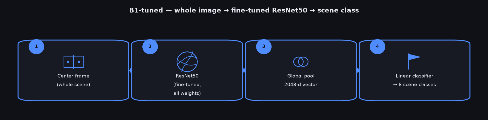

ResNet50 (ImageNet-pretrained) is fine-tuned end-to-end: the center frame of
each clip is fed through the backbone, globally pooled to a 2048-d vector,
and passed through a linear classifier over the 8 scene classes.

**Result: 72.2% test accuracy**, beating the paper's reported 66.7% for this
exact baseline.

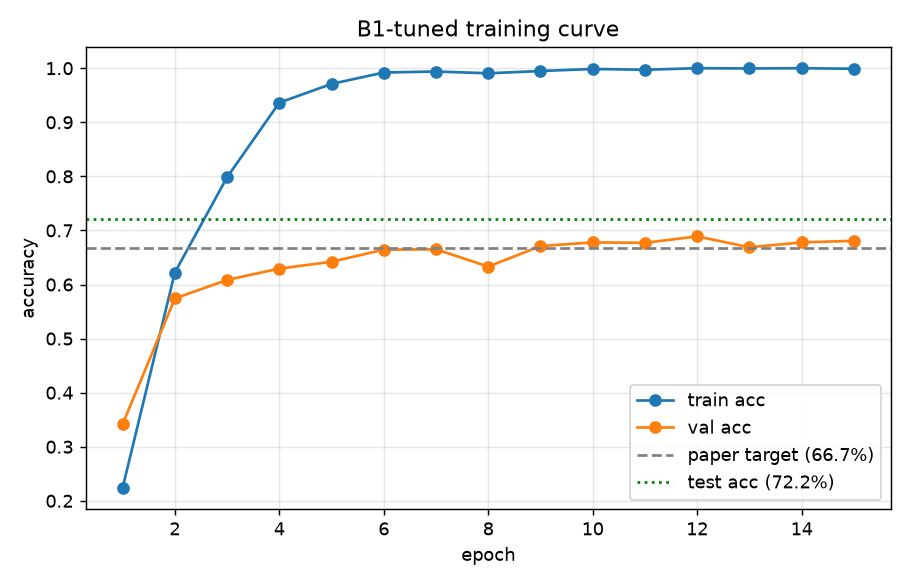

Train accuracy reaches ~100% by epoch 12 (clear overfitting on only 3,864
training images), but validation/test accuracy keeps climbing slightly
thanks to the weighted loss (corrects for class imbalance) and cosine LR
schedule — it doesn't collapse the way an unweighted/uncontrolled run would.

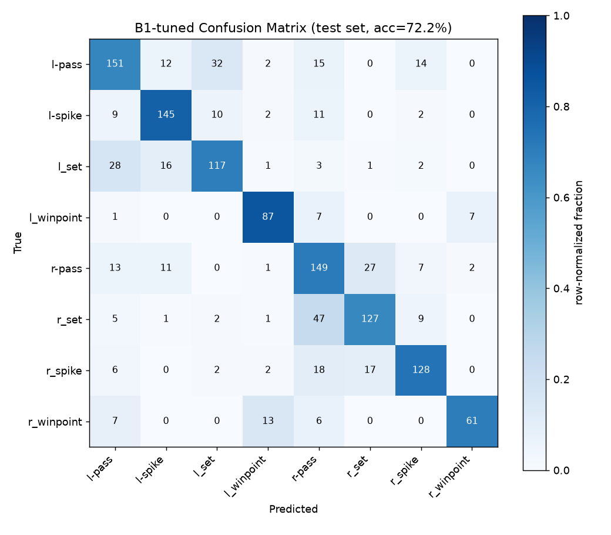

Reading the confusion matrix: almost all the error is between game phases of
the *same* team — `r-pass` gets confused with `r_set` (27 cases), `l-pass`
with `l_set` (32 cases) — because a single static frame often can't tell a
reception from a set-up without seeing the motion. This is exactly the
failure mode later baselines (B4+, which add an LSTM over the 9-frame
sequence) are designed to fix.

## B2 — explained

Paper name: **"Person Classification"**. Unlike B1, the input is **each
player's crop individually**, not the whole scene image — but the backbone
here is **never trained at all**: plain ImageNet weights, frozen.

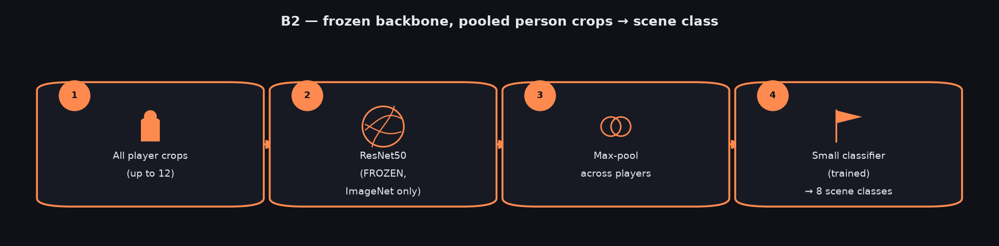

1. Take every player's bounding-box crop in the clip (up to 12).
2. Run each crop through ResNet50 — frozen, off-the-shelf ImageNet weights,
   no fine-tuning of any kind.
3. Max-pool the 12 player feature vectors (2048-d each) into one vector
   representing the whole clip.
4. Train only a small 2-layer classifier on top of that pooled vector ->
   8 scene classes.

Purpose: an ablation control. It answers "how far can we get using
person-level input with zero task-specific training?" — the gap between this
and B3 (same pipeline, but with a backbone fine-tuned on person actions
first) measures how much that fine-tuning is actually worth.

**Result: 42.2% test accuracy** — well below the paper's reported 64.6% for
this baseline.

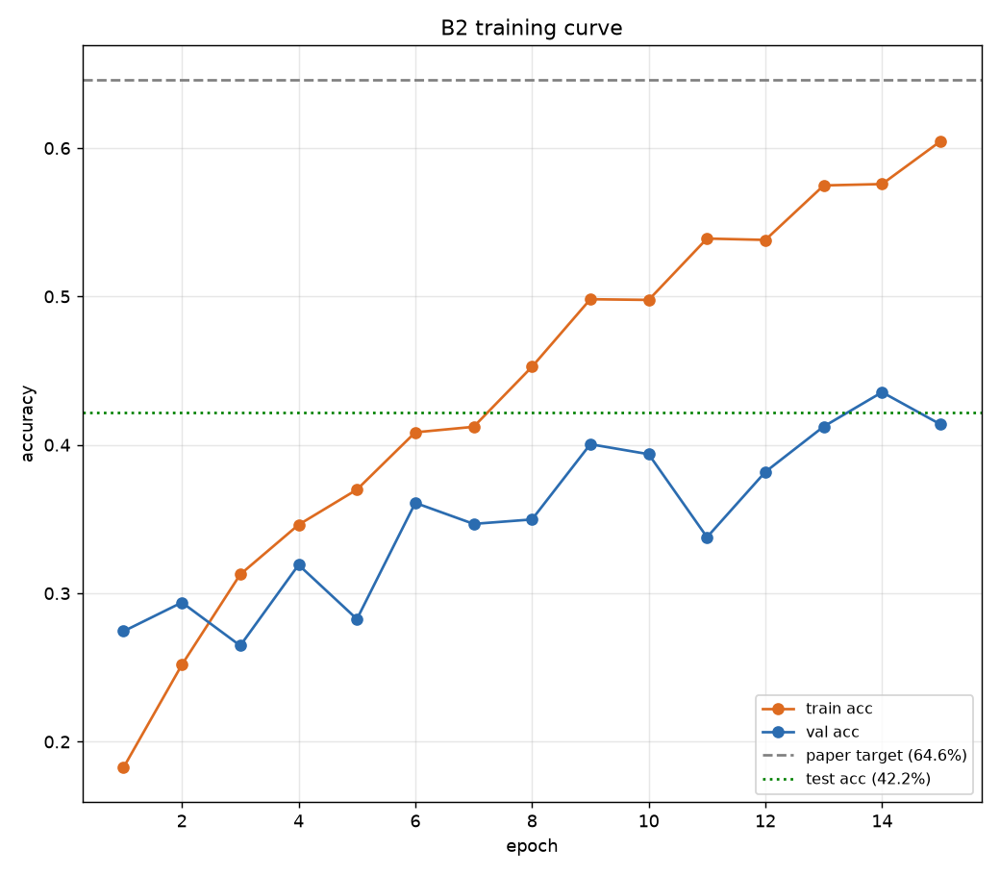

Unlike B1, train accuracy here is still climbing at epoch 15 (60.5%, not
plateaued) — the classifier head is learning from scratch on generic,
never-fine-tuned features, so it needs more epochs to fully converge. This
result is kept and reported as-is: B2's role in the ladder is a comparison
point, not a baseline to optimize — B3 (next) is the one that matters for the
main result chain.

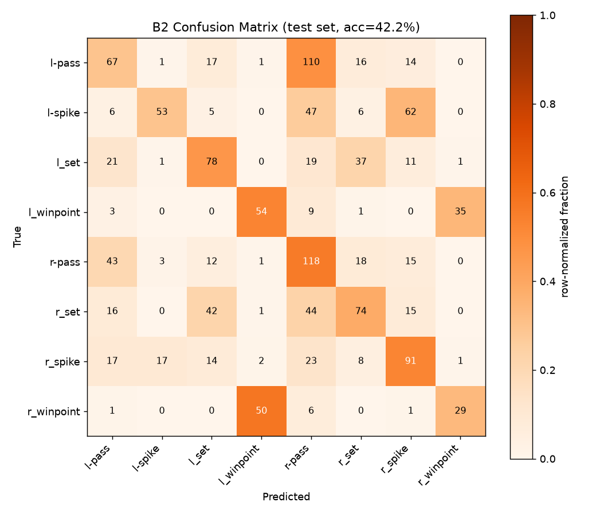

The confusion is much heavier and more spread out than B1's — e.g. `l-pass`
gets predicted as `r-pass` 110 times (its single biggest bucket, more than
the correct class itself). With no task-specific training, the pooled
features don't separate left-team vs right-team phases well at all, unlike
B1 where fine-tuning let the network learn that distinction directly.

## B3 — explained

Two separate steps, A then B+C. Step A is a full fine-tune (like B1, but on
a different task); steps B+C reuse B2's exact pipeline, just with a
fine-tuned backbone instead of a frozen one.

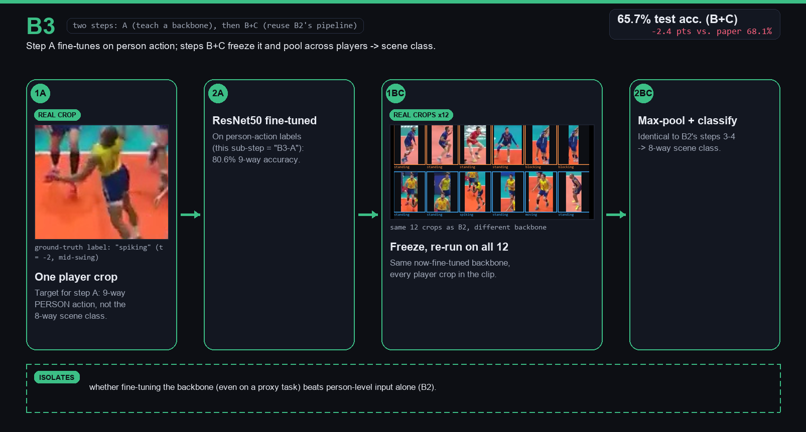

**Step A (= "B3-A"):** fine-tune ResNet50 end-to-end, but this time the
input is individual player crops and the target is the **9-way person
action** (`standing`, `spiking`, `blocking`, ...) — not the scene class.
This is an intermediate step: its own accuracy isn't reported in the paper's
tables, and isn't directly comparable to any other number here, because the
task (per-player action) is different from every other baseline (scene
activity).

Ran twice to fight severe class imbalance (`standing` is ~115x `jumping` in
the training set):

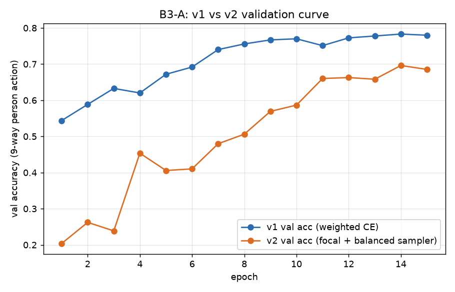

| | **v1**: weighted cross-entropy | **v2**: focal loss (γ=2) + class-balanced sampler |
|---|---|---|
| test accuracy (9-way) | **80.6%** | 72.8% |
| `jumping` recall | 19.1% | 7.9% (**worse**, despite targeting this exact problem) |
| `waiting` / `moving` recall | 47.0% / 67.6% | 60.2% / 70.3% (better) |

The counter-intuitive result: v2's fixes were aimed at the worst class
(`jumping`), but it got *worse* — with only 151 training images, the
balanced sampler redraws them ~18x per epoch, and combined with focal loss
up-weighting "hard" examples, the model appears to overfit (memorize) those
151 images rather than generalize. **v1 was selected** to feed every
downstream baseline (B2, B3 B+C, B5, B6, B7, B8) since it's stronger
overall and on 7 of 9 classes; `jumping`'s weakness is a known, carried-over
limitation, not something later baselines silently fix.

**Steps B+C:** freeze that backbone (v1), extract a 2048-d feature per
player crop, max-pool across all players in the clip, train a small
classifier on the pooled vector → 8-way scene class — **this is the number
comparable to the paper's 68.1%.**

**Result: 65.67% test accuracy** (−2.4 pts vs. the paper).

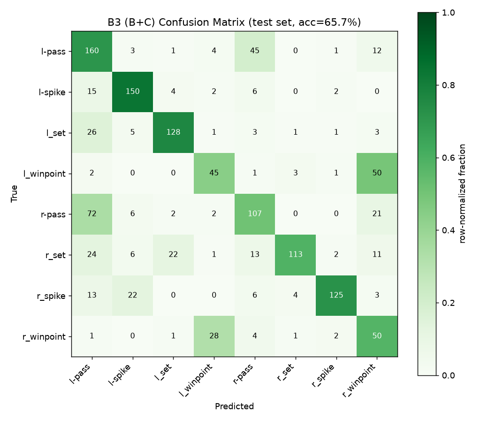

Reading it: `l-spike`/`r_spike` and `l_set`/`r_set` are classified well
(precision/recall both 0.72-0.93) — spiking and setting have distinctive
per-player poses that B3-A learned to recognize, and that signal survives
pooling. The weak spot is `r_winpoint` (precision only 0.333, confused with
`l_winpoint` 28 times and `r-pass` 72 times going the other way for
`r-pass`→`r_winpoint`-adjacent confusion) — "winning the point" isn't a
distinctive *pose* the way spiking is, so a model with no temporal context
and no explicit score/ball information struggles to tell it apart from
ordinary rallying. This is expected: B1 (66.7% target) and B3 (68.1% target)
are a close comparison in the paper too, not a blowout — B3's real advantage
over B1 is meant to show up once temporal modeling is layered on top (B5+),
which is what comes next.

## B4 — explained

First baseline with a **time** dimension — and the first one trained on
*cached* features rather than raw images (Phase B/C of the project's
VRAM-saving strategy).

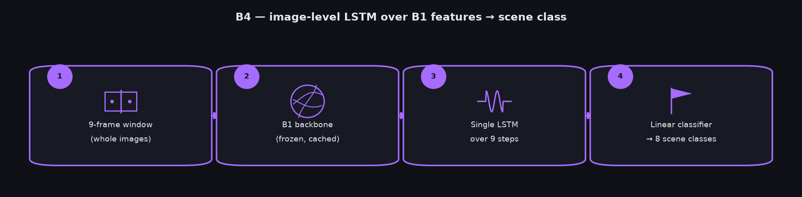

1. For each clip, take the **9-frame window** around the annotated center
   frame (not just one frame like B1).
2. Run each of the 9 frames through B1's already-trained backbone (frozen,
   features cached to disk beforehand — no backbone training happens here).
3. Feed the resulting 9-step sequence of 2048-d vectors into a **single
   LSTM**.
4. Classify the LSTM's final hidden state → 8-way scene class.

Still **no per-player information at all** — same blind spot as B1, just
with motion added. Players arrive in B5.

**Result: 73.37% test accuracy**, far above the paper's 63.1% target.

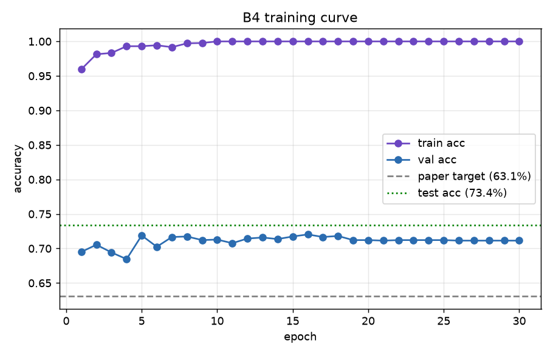

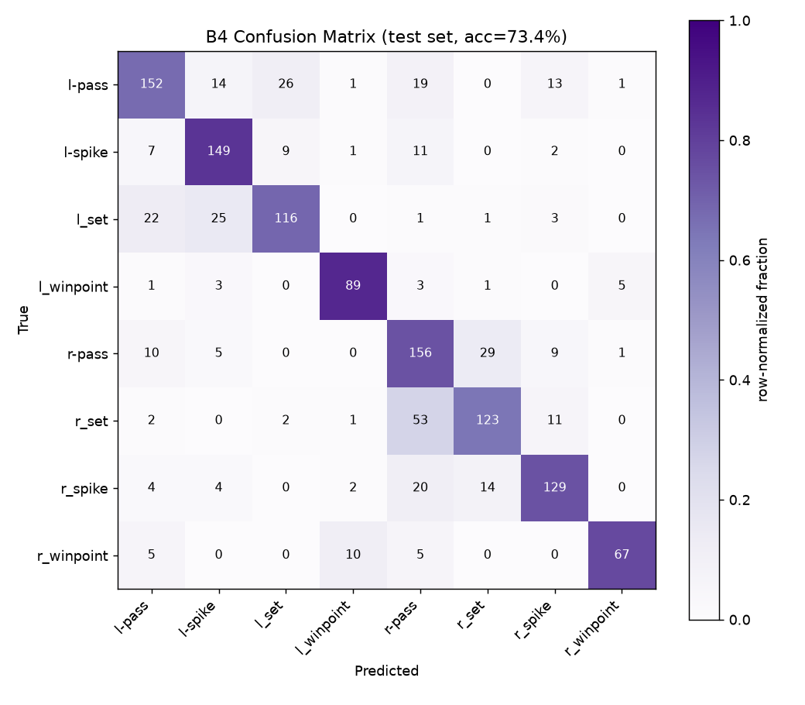

**Notable deviation from the paper's own finding:** the paper explicitly
says B4 performs *worse* than B1 on their volleyball data — a fast-moving
camera corrupts frame-to-frame background dynamics more than the added time
information helps. Here B4 (73.37%) slightly *beats* B1 (72.18%) instead,
most likely because ResNet50's much richer per-frame features give the LSTM
enough signal to overcome that camera-motion noise, where AlexNet's weaker
features couldn't.

## B5 — explained

Players arrive here. First baseline with a per-player LSTM, and the first
one where **how the player's box is tracked across the 9 frames actually
matters**.

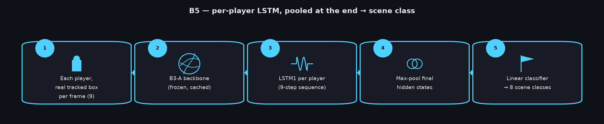

1. For each player, get their box in **each of the 9 frames individually**
   (not one box reused nine times — see below).
2. Run each crop through B3-A's backbone (frozen, cached) → a 2048-d feature
   per player per frame.
3. Feed each player's own 9-step sequence into **one LSTM** (shared weights
   across players) → take the final hidden state.
4. Max-pool the final hidden states across all players in the clip → linear
   classifier → 8-way scene class. No scene-level LSTM yet (that's B7/B8).

**Real tracking vs. the static-box simplification:** earlier baselines (and
this project's own first B5 run) used the Section 7.2 choice (a)
simplification — reuse the center frame's ground-truth box for all 9
frames, since the paper's brief explicitly allows it. But the paper itself
doesn't do this: it tracks real per-player tracklets with a Dlib tracker.
This repo now does the same, using `volleyball_tracking_annotation`:

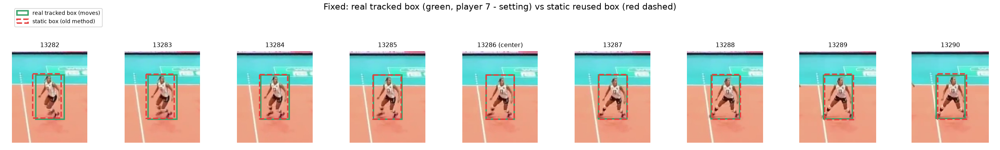

Each ground-truth player (box only at the center frame) is matched to a
track ID by IoU overlap at that frame (99.8% of players matched on a
100-clip sample), then each frame's crop uses that player's *actual* box at
that frame — not the center frame's box reused nine times. (Debugging note:
the tracking files store box *corners* `x1 y1 x2 y2`, not `x y width
height` despite the column layout looking similar — confirmed by comparing
against ground-truth boxes for the same player; worth knowing if anyone
else parses these files.)

**Result: 78.98% test accuracy** with real tracking (static box got 78.83%
— see below for why the two are so close despite the methodology being
meaningfully different), far above the paper's 67.6% target either way.

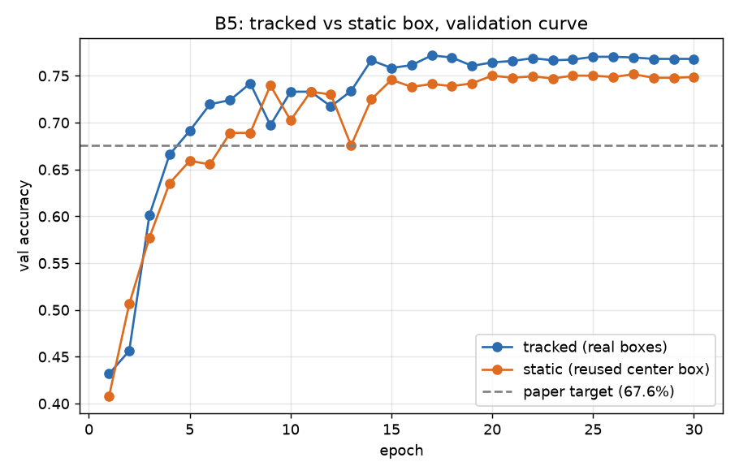

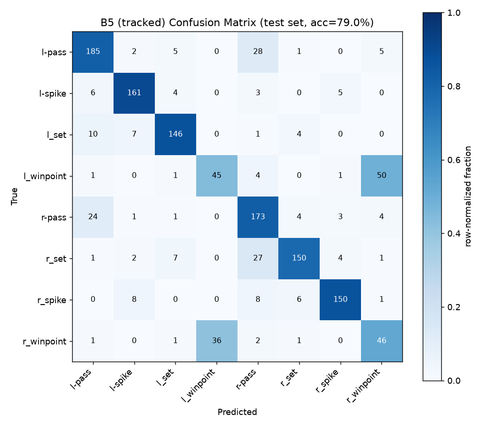

**Tracked vs. static, honestly:** the aggregate accuracy barely changes
(+0.15 pts), but per-class recall tells a more interesting story — `l-pass`,
`l-spike`, `l_set` all improve with real tracking (cleaner crops, less
background noise, less of the player cut off), while the two `winpoint`
classes move in *opposite* directions (`l_winpoint` −0.196, `r_winpoint`
+0.081). Likely explanation: `winpoint` moments involve unusual motion
(falling, celebrating) where the tracker itself is less reliable, so a more
"accurate" box isn't guaranteed to help there. Tracked boxes were still
chosen for B6/B7/B8 going forward, since matching the paper's actual
methodology is the right default even when the net accuracy gain is small
— full comparison in [`outputs/results/RESULTS.md`](outputs/results/RESULTS.md).

## B6 — explained

Same ingredients as B4 and B5 (players, time, pooling) but a different
*order*: pool the players first, within each frame, then run a single LSTM
over the pooled sequence — the reverse of B5, which runs a per-player LSTM
first and pools only at the very end.

1. For each of the 9 frames: take all players' B3-A features, max-pool
   across players → one vector per frame.
2. Feed the resulting 9-step sequence into a **single** LSTM (no
   per-player LSTM here).
3. Classify the final hidden state → 8-way scene class.

**First attempt (30 epochs, standard settings) underperformed badly: 64.47%
test accuracy** — below B4 (73.37%), B5 (78.98%), and the paper's 74.7%
target. Oddly, train accuracy itself only reached ~77% (every other
baseline hits ~99-100%), and 64.47% is barely above B3's 65.67% — a
baseline with *no LSTM at all*. That comparison is the key clue: the added
LSTM wasn't contributing much.

**Why:** max-pooling raw per-player features *before* any temporal
smoothing means the player whose value "wins" the max in a given feature
dimension can change from frame to frame. The LSTM ends up looking at a
sequence that jumps between different players' contributions rather than
one coherent, smoothly-evolving signal — the opposite of what an LSTM is
good at modeling. In B5, each player gets their own LSTM *before* pooling,
so the thing being pooled is already a smooth per-player summary, not raw
per-frame noise.

Extended training (3 resumed runs, 65 epochs total) mostly closed the gap:

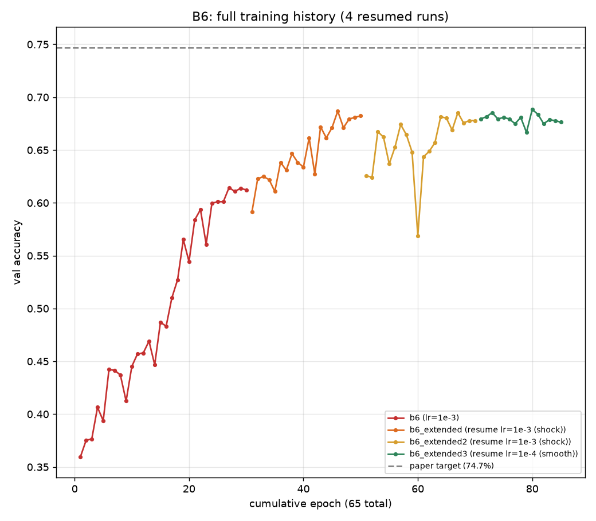

Along the way, a real bug surfaced: `--resume` loaded weights correctly but
the cosine LR schedule restarted from the top on every resumed run, causing
a visible accuracy "shock" right after each resume. Passing a low `--lr`
explicitly for the third resume fixed it (confirmed: no shock, smooth
continuation) — `train_temporal.py` now also saves a `<name>_last.pt`
checkpoint every epoch so a future resume can continue from the exact last
state instead of only the best-val snapshot.

**Final result: 73.15% test accuracy** (−1.6 pts vs. the paper), after
genuinely plateauing — train accuracy still crept up (95.9%) while val/test
accuracy went flat across the last ~35 epochs. Close to B4, but still well
below B5, consistent with the pool-before-LSTM structural handicap rather
than a simple "needed more training" story.

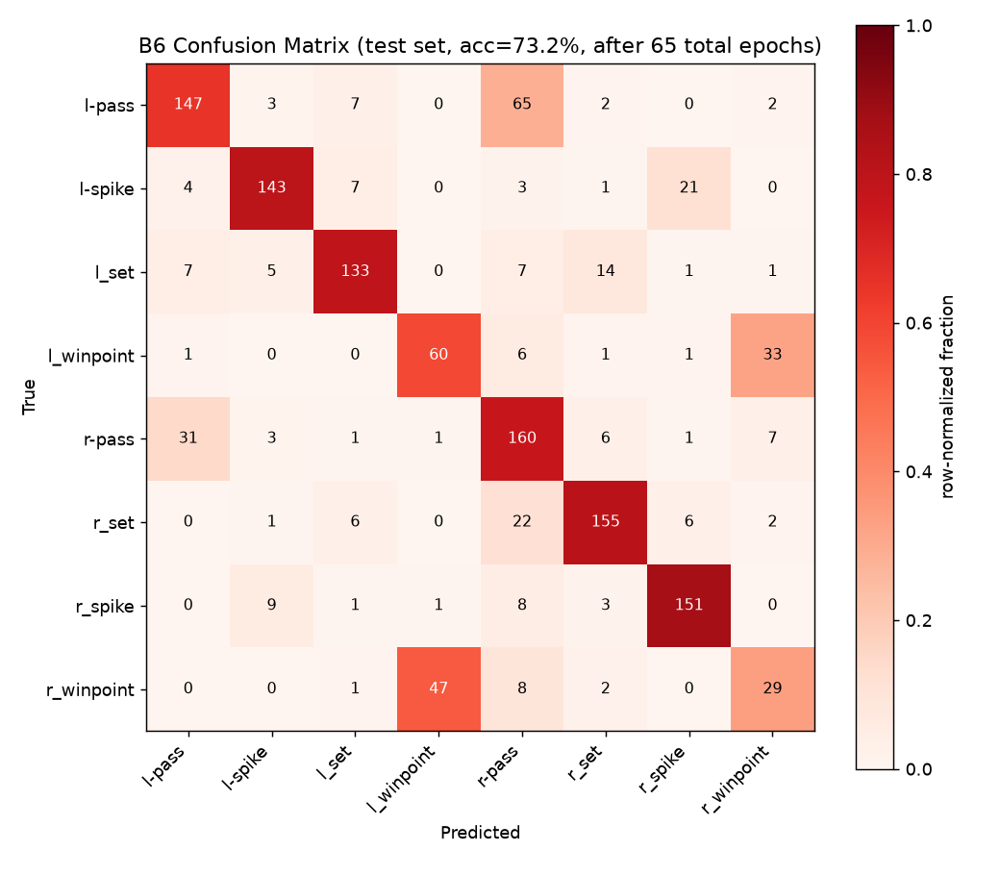

## Baseline ladder

Reproducing the paper's ablation study, from simplest to the full model.
Descriptions below are verified word-for-word against two sources: the
project brief (`CV Volleyball Project Details.pdf`, slides 8-15) and the
original CVPR 2016 paper's own Section 4.1 ("Baselines"), not inferred —
two earlier drafts of this table got B2 and B6 wrong, so this version
quotes the exact mechanism for each one.

| ID | Description | Paper target (test acc) | Our result |
|---|---|---|---|
| **B1-tuned** | Whole center-frame image → fine-tuned ResNet50 (all weights trainable) → 8-way scene class. No players, no time. | 66.7% | **72.2%** ✅ |
| **B2** | Paper name *"Person Classification"*. Every player's crop → **frozen, never-fine-tuned** ImageNet ResNet50 → max-pool the per-player features → small *trained* classifier → 8-way scene class. Pure ablation control (isolates "does fine-tuning matter?" from "does person-level input matter?"). | 64.6% | **42.2%** (documented as-is, see note below) |
| **B3** | Two steps. **(A)** fine-tune ResNet50 on individual player crops → 9-way *person action* class (this sub-step has no paper-reported accuracy of its own — it's an intermediate step, not the final metric). **(B+C)** freeze that backbone, extract a feature per player crop, max-pool across players, train a small classifier on the pooled vector → 8-way *scene* class — this is the number comparable to the paper's 68.1%. | 68.1% (scene, after B+C) | step A: 80.6% (9-way person-action, not comparable to 68.1%); **step B+C: 65.7%** ✅ |
| **B4** | *"Implementation #1"* from the brief: run B1's fine-tuned backbone over 9 whole-image frames per clip → one LSTM over the 9-step sequence → 8-way scene class. Image-level only, no players. | 63.1% | **73.4%** ✅ (paper's own B1>B4 finding reversed — see note above) |
| **B5** | *"Temporal on crops"*: one LSTM (LSTM1) per player over the 9-frame window using B3-A features → take each player's **last hidden state** → max-pool across players → small classifier (**no** scene-level LSTM) → 8-way scene class. | 67.6% | **79.0%** ✅ (real per-frame tracking, not the static-box simplification) |
| **B6** | *"Same B3 steps A and B, repeated per frame"*: for **each of the 9 frames**, take all player crops, extract B3-A features, max-pool across players → one vector per frame → 9-step sequence → a **single** LSTM over that sequence (image-level LSTM only, no per-player LSTM1) → 8-way scene class. | 74.7% | **73.2%** ✅ (needed 65 epochs — see "needed far more training" note above) |
| **B7** | Full two-stage model. LSTM1 (per player, over 9 frames) → for each frame, max-pool all players' LSTM1 outputs → LSTM2 (scene-level, over the resulting 9-step sequence) → 8-way scene class. | 80.2% | not started |
| **B8** | Same as B7, but *"group-style"* pooling: X = max-pool team 1's 6 players, Y = max-pool team 2's 6 players, scene representation = concat(X, Y) instead of one pool over all 12. The paper's best config. | 81.9% | not started |
| **B8-mt** | B8 + a per-player 9-way action head on LSTM1's output (before pooling), trained jointly: `loss = loss_scene + λ·loss_person_action` (Section 6, mandatory extension beyond the paper). | — (not a paper baseline) | not started |

**B2 vs B3 note:** both reuse the identical pooling pipeline
(`src/training/train_pooled_person.py`); the only difference is whether the
backbone that extracts per-player features was fine-tuned first (B3) or left
at raw ImageNet weights (B2). B2's 42.2% (vs. paper's 64.6%) is kept
documented as-is rather than re-tuned — see
[`outputs/results/RESULTS.md`](outputs/results/RESULTS.md) for why (the
small classifier head hadn't converged in 15 epochs on generic, untrained
features) and the full per-class breakdown.

Live results table: [`outputs/results/RESULTS.md`](outputs/results/RESULTS.md).

## Repo structure

```
src/
  data/         dataset loading, splits, PyTorch Dataset classes
  models/       ResNet50 backbone, LSTM1/LSTM2/pooling, classification heads
  training/     Phase A (backbone fine-tuning), Phase B (feature caching),
                Phase C (temporal models B4-B8)
  evaluation/   accuracy / confusion matrix / per-class precision-recall-F1
  inference/    video -> timestamped event timeline (later stage)
  ball/         ball-presence detection (later stage, best-effort)
outputs/
  checkpoints/  trained model weights (tracked via Git LFS)
  results/      per-baseline metrics (JSON + text report) and RESULTS.md
  features_cache/  cached backbone features for Phase C (not committed, large)
configs/        per-baseline hyperparameter configs (as needed)
```

## Setup

```bash
python -m venv .venv
.venv\Scripts\python.exe -m pip install torch torchvision --index-url https://download.pytorch.org/whl/cu124
.venv\Scripts\python.exe -m pip install tqdm
```

## Training a baseline

Exact command for every baseline lives in `configs/<id>.yaml`. Summary:

```bash
# B1: fine-tune ResNet50 on whole clip images -> 8-way scene class
.venv\Scripts\python.exe -m src.training.train_backbone --task scene --mode finetune --epochs 15 --batch-size 24 --name scene_finetune_b1

# B3-A: fine-tune ResNet50 on person crops -> 9-way action class (needed for B2, B3, B5, B6, B7, B8)
.venv\Scripts\python.exe -m src.training.train_backbone --task person --mode finetune --epochs 15 --batch-size 24 --name person_finetune_b3a

# B2: frozen ImageNet backbone, pooled person crops -> 8-way scene class
.venv\Scripts\python.exe -m src.training.train_pooled_person --backbone-mode frozen --epochs 15 --batch-size 16 --name person_pooled_b2

# B3 (B+C): B3-A's fine-tuned backbone, pooled person crops -> 8-way scene class
.venv\Scripts\python.exe -m src.training.train_pooled_person --backbone-checkpoint outputs/checkpoints/person_finetune_b3a.pt --backbone-mode finetune --epochs 15 --batch-size 16 --name person_pooled_b3

# Phase B: cache features from a trained backbone (needed for B4-B8)
.venv\Scripts\python.exe -m src.training.cache_features --level image --checkpoint outputs/checkpoints/scene_finetune_b1.pt --name b1_image
.venv\Scripts\python.exe -m src.training.cache_features --level person --checkpoint outputs/checkpoints/person_finetune_b3a.pt --name b3a_person

# Phase C: train a temporal model on cached features (B4, B5, B6, B7, B8, B8-mt)
.venv\Scripts\python.exe -m src.training.train_temporal --variant b7 --feature-name b3a_person
```

Handling severe class imbalance in the 9-way person-action labels (`standing`
outnumbers `jumping` ~100:1): `train_backbone.py --task person` supports
`--loss focal --gamma 2.0` (focal loss, on top of the default class weights)
and `--sampler balanced` (`WeightedRandomSampler` — gives every class roughly
equal expected exposure per epoch, effectively oversampling rare classes and
undersampling `standing` at the same time).

## Status

See [`outputs/results/RESULTS.md`](outputs/results/RESULTS.md) for current progress against the baseline ladder.
