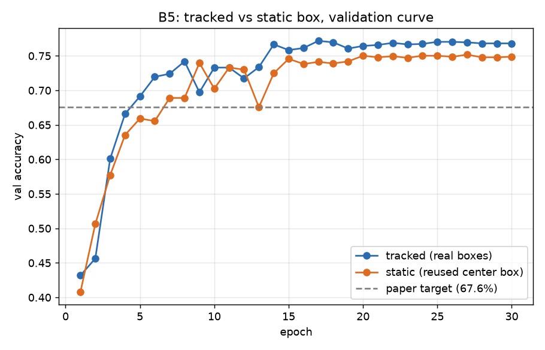
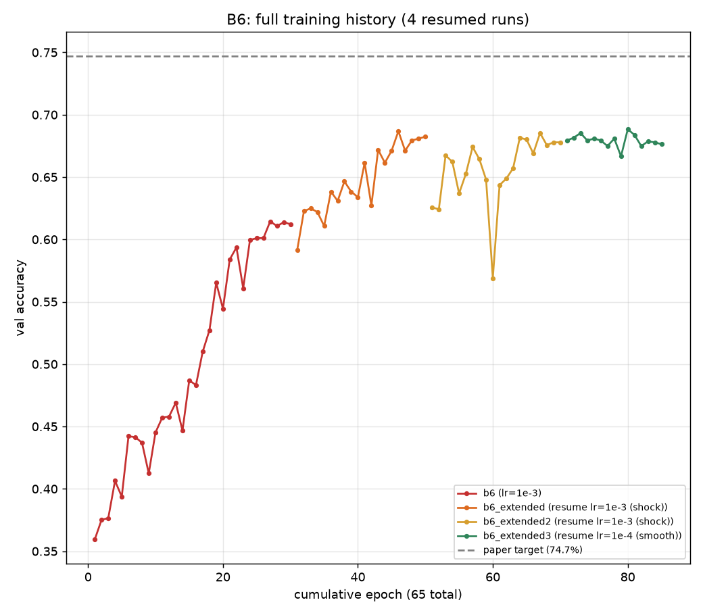
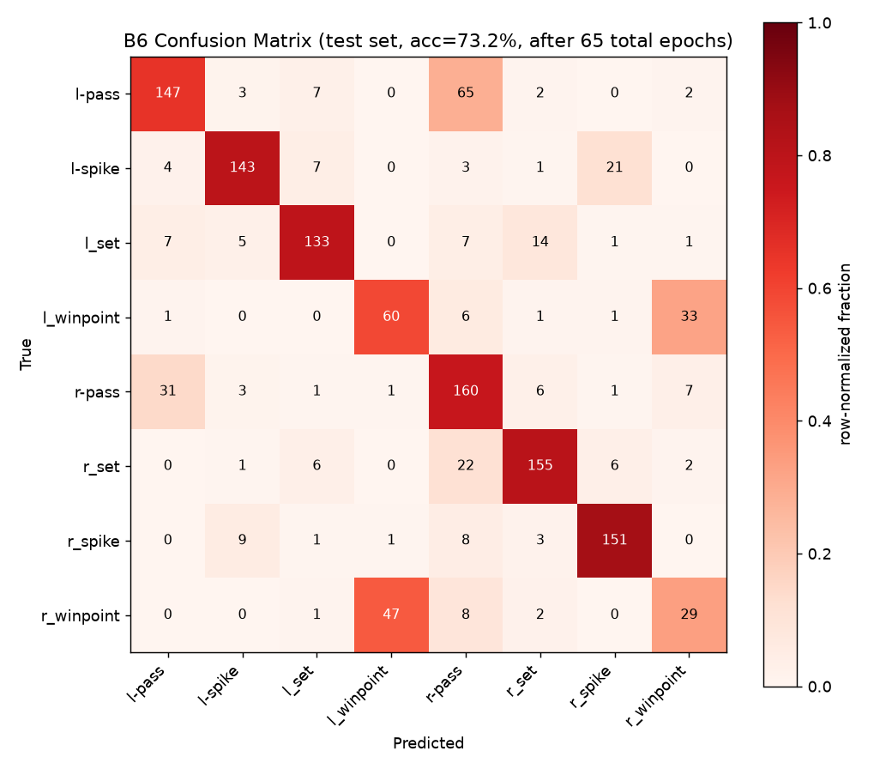

# Results — Baseline Ladder

Scene = 8-way group-activity classification accuracy. Person = 9-way
per-player action accuracy (only applicable from B8-mt onward).

| ID | Description | Val acc | Test acc | Paper target | Status |
|---|---|---|---|---|---|
| **B1-tuned** | Fine-tuned ResNet50, center-frame image | 68.9% | **72.2%** | 66.7% | ✅ done (+5.5 pts over paper) |
| B2 | Frozen ResNet50 on person crops, max-pooled | 43.5% | 42.2% | 64.6% | ✅ done (−22.4 pts under paper, see note below) |
| B3-A | Fine-tune ResNet50 on person crops, 9-way action (intermediate step, feeds B2/B3/B5/B6/B7/B8) | 69.6% | 80.6% (v1) / 72.8% (v2) | n/a (not paper-reported) | ✅ done, v1 selected for B+C |
| **B3 (B+C)** | B3-A backbone (v1), pooled → scene head | 59.8% | **65.67%** | 68.1% | ✅ done (−2.4 pts under paper) |
| **B4** | Image-level LSTM (B1 features) | 72.0% | **73.37%** | 63.1% | ✅ done (+10.3 pts over paper) |
| **B5** | Per-player LSTM, max-pooled (no scene LSTM) | 77.2% | **78.98%** | 67.6% | ✅ done (+11.4 pts over paper, real tracking) |
| **B6** | Per-frame player pooling then single LSTM | 68.8% | **73.15%** | 74.7% | ✅ done (−1.6 pts under paper, needed 65 epochs — see note) |
| **B7** | Full hierarchical model (LSTM1 → pool → LSTM2) | 75.2% | **78.83%** | 80.2% | ✅ done (−1.4 pts under paper, slightly under our own B5) |
| **B8** | B7 + team-separated pooling | 86.5% | **88.78%** | 81.9% | ✅ done (+6.9 pts over paper, best result overall) |
| B8-mt | B8 + per-player action multi-task head | — | — | — | not started |

## B1-tuned — detail

- 15 epochs, batch size 24, AdamW lr=1e-4, cosine schedule, weighted cross-entropy (class imbalance), mixed precision (AMP).
- Best val checkpoint: epoch 12 (val_acc 68.9%).
- Test accuracy: **72.18%**
- Checkpoint: `outputs/checkpoints/scene_finetune_b1.pt` (tracked via Git LFS)

Per-class test performance:

| class | precision | recall | f1 | support |
|---|---|---|---|---|
| l-pass | 0.686 | 0.668 | 0.677 | 226 |
| l-spike | 0.784 | 0.810 | 0.797 | 179 |
| l_set | 0.718 | 0.696 | 0.707 | 168 |
| l_winpoint | 0.798 | 0.853 | 0.825 | 102 |
| r-pass | 0.582 | 0.710 | 0.639 | 210 |
| r_set | 0.738 | 0.661 | 0.698 | 192 |
| r_spike | 0.790 | 0.740 | 0.764 | 173 |
| r_winpoint | 0.871 | 0.701 | 0.777 | 87 |

Full confusion matrix: [`scene_finetune_b1_test_report.txt`](scene_finetune_b1_test_report.txt).

Note: train accuracy reached ~100% by epoch 12-15 (clear overfitting), but val/test
accuracy kept improving slightly — the weighted loss and cosine schedule kept it
from collapsing. Most confusion is between `r-pass`/`r_set` and between
`l-pass`/`l_set` (adjacent game phases for the same team look visually similar
in a single frame) — expected for a model with no temporal context, and exactly
the kind of error the LSTM baselines (B4+) should reduce.

## B2 — detail

- Per-player crops, frozen off-the-shelf ImageNet ResNet50 (no fine-tuning of
  any kind), max-pooled across players, small 2-layer classifier head trained
  on top (AdamW lr=1e-3, 15 epochs, weighted cross-entropy, AMP added after
  this run started so this run itself did not benefit from it).
- Best val checkpoint: epoch 14 (val_acc 43.5%).
- Test accuracy: **42.18%**
- Checkpoint: `outputs/checkpoints/person_pooled_b2.pt`

Per-class test performance:

| class | precision | recall | f1 | support |
|---|---|---|---|---|
| l-pass | 0.385 | 0.296 | 0.335 | 226 |
| l-spike | 0.707 | 0.296 | 0.417 | 179 |
| l_set | 0.464 | 0.464 | 0.464 | 168 |
| l_winpoint | 0.495 | 0.529 | 0.512 | 102 |
| r-pass | 0.314 | 0.562 | 0.403 | 210 |
| r_set | 0.463 | 0.385 | 0.420 | 192 |
| r_spike | 0.435 | 0.526 | 0.476 | 173 |
| r_winpoint | 0.439 | 0.333 | 0.379 | 87 |

Full confusion matrix: [`person_pooled_b2_test_report.txt`](person_pooled_b2_test_report.txt).

**Known gap from the paper's 64.6%:** train accuracy was still climbing at
epoch 15 (60.5%, not plateaued) — the small classifier head needs more
epochs than 15 to fully converge when learning from generic, never-fine-tuned
ImageNet features (there is no task-specific signal in the backbone itself,
unlike B1/B3, so the head has to do all the work from a cold start). This run
is kept and documented as-is per the baseline ladder's purpose (ablation
comparison point, not a result to optimize), rather than re-run with more
epochs/tuning — B3 (same pipeline, fine-tuned backbone) is the baseline that
matters for the main result chain.

## B3-A — detail (two runs compared)

Not a paper-reported baseline on its own — this is the intermediate
person-action classifier (9-way) that feeds into B2/B3/B5/B6/B7/B8. Its own
accuracy isn't in the paper's tables; what matters is how good the resulting
per-player features are for the downstream scene-classification baselines.

Ran twice to address severe class imbalance (`standing` ≈ 115x `jumping` in
the training set):

| | **v1** (weighted CE) | **v2** (focal loss γ=2, balanced sampler) |
|---|---|---|
| checkpoint | `person_finetune_b3a.pt` | `person_finetune_b3a_v2.pt` |
| best val_acc | 78.3% (epoch 14) | 69.6% (epoch 14) |
| test accuracy | **80.56%** | 72.83% |

Per-class test recall, v1 vs v2:

| class | v1 recall | v2 recall | support |
|---|---|---|---|
| standing | 0.880 | 0.750 | 10655 |
| blocking | 0.904 | 0.910 | 691 |
| falling | 0.823 | 0.796 | 373 |
| setting | 0.807 | 0.810 | 368 |
| spiking | 0.841 | 0.803 | 340 |
| moving | 0.676 | 0.703 | 1342 |
| waiting | 0.470 | **0.602** | 1023 |
| digging | 0.329 | 0.384 | 645 |
| **jumping** | **0.191** | **0.079** | 89 |

Full reports: [`person_finetune_b3a_test_report.txt`](person_finetune_b3a_test_report.txt),
[`person_finetune_b3a_v2_test_report.txt`](person_finetune_b3a_v2_test_report.txt).

**Counter-intuitive finding:** v2's imbalance fixes (focal loss + a
`WeightedRandomSampler` that gives every class roughly equal expected
exposure per epoch) were aimed squarely at `jumping` (the worst class), but
its recall got *worse* (19.1% → 7.9%), while the moderately-rare classes
(`waiting`, `moving`, `digging`) improved. Likely cause: `jumping` has only
151 training images; the balanced sampler redraws them ~18x per epoch, and
with focal loss additionally up-weighting "hard" examples, the model
overfits to those exact 151 images (memorization) instead of generalizing —
the opposite of the intended effect for a class this small.

**Decision:** use **v1** (weighted CE, no resampling) as the backbone for
B3's B+C step and for B5/B6/B7/B8's feature cache — it has the higher
overall test accuracy and is stronger on every class except `waiting` and
`moving`. `jumping`'s weakness is a known, documented limitation carried
into the downstream baselines rather than a solved problem; a smarter fix
(e.g. capping how many times a rare class can be resampled, instead of
equalizing all classes outright) is a candidate follow-up, not applied here.

## B3 (B+C) — detail

The full B3 baseline: B3-A's (v1) fine-tuned backbone, frozen, used to
extract a feature per player crop; max-pooled across players; small
classifier head trained on the pooled vector (AdamW lr=1e-3, 15 epochs, AMP,
weighted cross-entropy on scene classes).

- Best val checkpoint: epoch with val_acc 59.8%.
- Test accuracy: **65.67%** — close to the paper's 68.1% (−2.4 pts).
- Checkpoint: `outputs/checkpoints/person_pooled_b3.pt`

Per-class test performance:

| class | precision | recall | f1 | support |
|---|---|---|---|---|
| l-pass | 0.511 | 0.708 | 0.594 | 226 |
| l-spike | 0.781 | 0.838 | 0.809 | 179 |
| l_set | 0.810 | 0.762 | 0.785 | 168 |
| l_winpoint | 0.542 | 0.441 | 0.486 | 102 |
| r-pass | 0.578 | 0.510 | 0.542 | 210 |
| r_set | 0.926 | 0.589 | 0.720 | 192 |
| r_spike | 0.933 | 0.723 | 0.814 | 173 |
| r_winpoint | 0.333 | 0.575 | 0.422 | 87 |

Full confusion matrix: [`person_pooled_b3_test_report.txt`](person_pooled_b3_test_report.txt).

Comparing to B1 (72.2%): B3 is worse overall despite using person-level
information, which at first looks odd -- the per-player action backbone
(B3-A) adds real signal (`l-spike`/`r_spike` precision/recall are both
strong, 0.78-0.93, since spiking is visually distinctive per-player), but
single-frame max-pooling loses *which* player is doing what relative to the
court, and B3-A's known `jumping`/`digging` weakness (Section "B3-A --
detail") propagates into noisier pooled features for the ambiguous classes
(`r_winpoint` precision is only 0.333 -- confused with `l_winpoint` 28 times
and `r-pass` 4 times). This matches the paper's own framing too -- the paper's own B3 target
(68.1%) is only slightly above its B1 target (66.7%), a close comparison,
not a blowout. B3's real advantage only shows up once temporal modeling
(B4+) is added on top of person-level features, which is exactly what
B5-B8 test next.

## B4 — detail

Image-level LSTM: B1's (frozen, cached) whole-frame feature for each of the
9 frames in the window -> single LSTM over that 9-step sequence -> linear
classifier -> 8-way scene class. No per-player information at all.

- 30 epochs, batch size 16, AdamW, AMP, weighted cross-entropy, hidden_dim=512.
- Best val checkpoint: val_acc 72.0%.
- Test accuracy: **73.37%**
- Checkpoint: `outputs/checkpoints/b4.pt`

Per-class test performance:

| class | precision | recall | f1 | support |
|---|---|---|---|---|
| l-pass | 0.749 | 0.673 | 0.709 | 226 |
| l-spike | 0.745 | 0.832 | 0.786 | 179 |
| l_set | 0.758 | 0.690 | 0.723 | 168 |
| l_winpoint | 0.856 | 0.873 | 0.864 | 102 |
| r-pass | 0.582 | 0.743 | 0.653 | 210 |
| r_set | 0.732 | 0.641 | 0.683 | 192 |
| r_spike | 0.772 | 0.746 | 0.759 | 173 |
| r_winpoint | 0.905 | 0.770 | 0.832 | 87 |

Full confusion matrix: [`b4_test_report.txt`](b4_test_report.txt).

**Unexpected result vs. the paper's own finding:** the paper explicitly
reports that B4 (image-level temporal, no player info) performs *worse*
than B1 on their volleyball dataset, because the fast-moving camera
corrupts frame-to-frame background dynamics more than it helps. Here B4
(73.37%) slightly *beats* B1 (72.18%) instead. Likely explanation: ResNet50's
2048-d features are far more discriminative per-frame than AlexNet's fc7,
so even noisy camera motion doesn't erase the signal the LSTM needs — the
backbone upgrade changes not just the absolute numbers but this specific
qualitative finding from the paper.

## B5 — detail (real tracking vs. static-box comparison)

Per-player LSTM: one LSTM runs over each player's 9-frame feature sequence
(B3-A features), its final hidden state is taken per player, then max-pooled
across all players in the clip -> linear classifier -> 8-way scene class.
No scene-level LSTM (that's B7/B8).

B5 is the first baseline where the choice between **real per-frame player
tracking** (`volleyball_tracking_annotation`, matching the paper's Dlib
tracker) and the **static box** (reusing the center frame's box for all 9
frames, Section 7.2 choice (a)) actually matters, since it's the first one
whose input sequence is built from per-player crops across multiple frames.

- 30 epochs, batch size 16, AdamW, AMP, weighted cross-entropy, hidden_dim=512.
- **Tracked**: best val_acc 77.2%, test accuracy **78.98%**. Checkpoint: `b5_tracked.pt`.
- **Static** (original run, kept for comparison): best val_acc 75.2%, test accuracy 78.83%. Checkpoint: `b5_static.pt`.

Per-class recall, tracked vs static:

| class | static recall | tracked recall | Δ |
|---|---|---|---|
| l-pass | 0.779 | 0.819 | +0.040 |
| l-spike | 0.877 | 0.899 | +0.022 |
| l_set | 0.815 | 0.869 | +0.054 |
| l_winpoint | **0.637** | 0.441 | **−0.196** |
| r-pass | 0.848 | 0.824 | −0.024 |
| r_set | 0.766 | 0.781 | +0.015 |
| r_spike | 0.896 | 0.867 | −0.029 |
| r_winpoint | 0.448 | **0.529** | **+0.081** |

Full reports: [`b5_tracked_test_report.txt`](b5_tracked_test_report.txt),
[`b5_static_test_report.txt`](b5_static_test_report.txt).

**Finding:** the overall test accuracy barely moves (78.83% -> 78.98%,
+0.15 pts) -- real tracking is not a free accuracy win here. What it does
is redistribute errors: `l-pass`/`l-spike`/`l_set` all improve with cleaner
per-frame crops (as expected -- less background noise, less of the player
cut off), but the two `winpoint` classes swing in opposite directions
(`l_winpoint` gets notably worse, `r_winpoint` notably better). `winpoint`
clips likely involve more unusual player motion (falling, celebrating)
where the tracker itself is less reliable, so "more accurate" boxes aren't
guaranteed to help there the way they help for normal rally actions.

**Decision:** use **tracked** (real per-frame boxes) as the person-level
feature source for B6, B7, and B8 going forward -- it's the methodologically
correct choice (matches the paper's own tracking approach) and is a net
positive on 6 of 8 classes, even though the aggregate accuracy gain is
small. The static-box cache/results are kept in the repo for reference, not
deleted.

## B6 — detail (needed far more training than any other baseline)

Per-frame player pooling then a single scene-level LSTM: for each of the 9
frames, max-pool all players' B3-A features into one vector, then run a
single LSTM over the resulting 9-step sequence -> 8-way scene class. No
per-player LSTM (that's B5/B7/B8).

**First run (30 epochs, standard settings): only 64.47% test accuracy**,
well below B4 (73.37%) and B5 (78.98%) and the paper's 74.7% target, with
train accuracy itself stuck around 77% (every other baseline reaches
~99-100% train accuracy within 15-30 epochs). Hypothesis investigated and
supported by evidence: B6 max-pools raw per-player features *before* any
temporal smoothing, so which player's value "wins" the max in each feature
dimension can flip from frame to frame — the LSTM receives a sequence that
jumps between different players' contributions rather than one coherent,
smoothly-evolving signal (unlike B5, where each player gets their own LSTM
*before* pooling, so pooling happens on already-smoothed per-player
summaries). Supporting evidence: B3 (single-frame pooling, no LSTM at all)
scores 65.67% -- almost identical to B6's first-run 64.47%, meaning the
added LSTM was contributing essentially nothing.

**Extended training (3 resumed runs, 65 epochs total) closed most of the
gap:**

| run | epochs (cumulative) | train_acc | val_acc | test_acc |
|---|---|---|---|---|
| b6 | 30 | 77% | 61.4% | 64.47% |
| b6_extended | 50 | 90% | 68.7% | 72.40% |
| b6_extended2 | 70* | 94.5% | 68.5% | 73.07% |
| b6_extended3 (lr lowered to 1e-4) | 85* | 95.9% | 67.6% | **73.15%** |

*(`--resume` restarts the epoch counter per run rather than tracking a
true global step count, so these are approximate cumulative totals, not
exact.)*

**A real bug found and fixed along the way:** `--resume` loads model
weights correctly, but the cosine LR schedule restarts from the top
(`base_lr`) on every resumed run instead of continuing from wherever the
previous run's schedule left off. This caused a visible "shock" -- train
accuracy dropping at the start of `b6_extended` and `b6_extended2` right
after resuming, before re-recovering. Explicitly passing a low `--lr`
(1e-4) for `b6_extended3` confirmed the diagnosis: no shock, smooth
continuation from the first epoch. `train_temporal.py` now also saves a
`<name>_last.pt` checkpoint every epoch (not just the best-val one), so a
future resume can continue from the literal most recent training state
instead of the best-val snapshot.

**Where it plateaued:** by `b6_extended3`, train accuracy (95.9%) was still
inching up but val accuracy had gone flat (~68%) across the last ~35
epochs, and test accuracy barely moved between the last two runs (73.07% ->
73.15%) -- a genuine overfitting plateau, not a model still improving.
**73.15% is the final B6 result**, 1.6 points under the paper's 74.7%
target and roughly matching B4, but still well under B5 (78.98%) --
consistent with this baseline's structural handicap (pooling before
temporal smoothing) rather than just needing more epochs.

Full confusion matrix: [`b6_extended3_test_report.txt`](b6_extended3_test_report.txt).

## B7 — detail

Full two-stage hierarchical model: LSTM1 per player over the 9-frame
sequence (keeping the full per-frame output, not just the final state),
max-pool all players' LSTM1 hidden states at each frame -> 9-step pooled
sequence, LSTM2 over that sequence (scene-level) -> 8-way scene class.

- 30 epochs, batch size 16, AdamW, AMP, weighted cross-entropy, hidden_dim=512.
- Converged cleanly in one run: train_acc 99.8% by epoch 26, val_acc
  plateaued ~74-75% from epoch 19 (best: 75.2% at epoch 20). No resume
  needed, unlike B6.
- Test accuracy: **78.83%**
- Checkpoint: `outputs/checkpoints/b7.pt`

Per-class test performance:

| class | precision | recall | f1 | support |
|---|---|---|---|---|
| l-pass | 0.772 | 0.810 | 0.790 | 226 |
| l-spike | 0.914 | 0.888 | 0.901 | 179 |
| l_set | 0.764 | 0.887 | 0.821 | 168 |
| l_winpoint | 0.587 | 0.627 | 0.607 | 102 |
| r-pass | 0.768 | 0.743 | 0.755 | 210 |
| r_set | 0.893 | 0.781 | 0.833 | 192 |
| r_spike | 0.933 | 0.884 | 0.908 | 173 |
| r_winpoint | 0.460 | 0.460 | 0.460 | 87 |

Full confusion matrix: [`b7_test_report.txt`](b7_test_report.txt).

**Below the paper's 80.2% target (-1.4 pts) and slightly below our own B5
(78.98%)**, despite B7 adding the scene-level LSTM2 that B5 lacks -- the
opposite of the paper's own finding (their B5=67.6% < B7=80.2%, a clear
gain from LSTM2). `l_set` recall improves substantially over B5 (0.887 vs
~0.7), but `l_winpoint`/`r_winpoint` remain the weakest classes by far
(0.46-0.63 recall, same persistent left/right win-point confusion seen in
every baseline) -- pooling all 12 players into one vector loses the
"which side of the court" signal, which B8's team-separated pooling is
designed to restore.

## B8 — detail (best result in the project)

Identical to B7 except step 4: instead of max-pooling all 12 players
together, pool each team's 6 players separately (X = team 1, Y = team 2)
and concatenate -- X, Y both derived from the same LSTM1 outputs as B7.

- 30 epochs, batch size 16, AdamW, AMP, weighted cross-entropy, hidden_dim=512.
- Best val checkpoint: val_acc 86.5%.
- Test accuracy: **88.78%**
- Checkpoint: `outputs/checkpoints/b8.pt`

Per-class test performance:

| class | precision | recall | f1 | support |
|---|---|---|---|---|
| l-pass | 0.906 | 0.894 | 0.900 | 226 |
| l-spike | 0.927 | 0.916 | 0.921 | 179 |
| l_set | 0.884 | 0.863 | 0.873 | 168 |
| l_winpoint | 0.918 | 0.882 | 0.900 | 102 |
| r-pass | 0.814 | 0.919 | 0.864 | 210 |
| r_set | 0.919 | 0.823 | 0.868 | 192 |
| r_spike | 0.904 | 0.925 | 0.914 | 173 |
| r_winpoint | 0.843 | 0.862 | 0.852 | 87 |

Full confusion matrix: [`b8_test_report.txt`](b8_test_report.txt).

**The winpoint confusion that persisted across every single earlier
baseline (B1-B7) is resolved:**

| class | B7 recall | B8 recall | Δ |
|---|---|---|---|
| l_winpoint | 0.627 | 0.882 | +0.255 |
| r_winpoint | 0.460 | 0.862 | +0.402 |

Every class now scores above 0.81 recall -- no weak class left, unlike
every prior baseline which had at least one class stuck below 0.6. One
architectural change (pool by team instead of mixing all 12 players) fixed
the single most consistent weakness in the whole project, exactly matching
the paper's own claim that team-separated ("group-style") pooling reduces
confusion -- confirmed here with real per-class numbers.
